# Tervisehull Data Model and Planned Content Architecture

## Purpose

This document defines the health knowledge contract for Tervisehull: where medical content lives, how drugs/supplements/foods/conditions/measurements are normalized, how approved articles and references connect to user-facing interaction messages, and how user profile data is separated from medical knowledge data.

The product boundary for MVP is safety information and GP/pharmacist conversation support. The system may identify possible interactions, explain why they matter, and flag when a user's profile makes an interaction worth further investigation. It must not tell a user to start, stop, replace, or change the dose of a medicine or supplement.

## Source Materials

Package status (2026-11-05): this branch adds the standalone PostgreSQL schema
and demonstration data under `db/`. The three bootstrap scripts define the current
40-table database. The API endpoints, service layout, future tables and workflows
described below are design context, not application implementations in this branch.
The existing repository backend has a separate schema and Flyway history; integrating
it requires an explicit migration and ownership/audit-column mapping.

The SQL matcher checks exact concept participants and publication gates. It does
not evaluate conditions, measurements, dose thresholds, ingredient expansion,
concept descendants or personal risk modifiers. The schema can store this context;
storing it does not implement its evaluation.

All imported content is demonstration material. Seed approval flags, synthetic
reviewer records and copied English/Estonian text are not clinical release approval.
The nondrug catalog also needs reviewed type normalization. The source metadata
contains a known duplicate article, and 270 of the 300 source rows are search links
awaiting review. See [the database guide](../README.md) for current behavior and tests.

The current seed model was derived from these original authoring files, which are
not included in this database-only package:

- `docs/Andmemudeli tööfaili põhjalikum versioon.xlsx`
- `docs/Andmemudeli tööfail.xlsx`
- `docs/Blablabla.docx`

The detailed workbook already contains these useful domains:

- `interaction_rules`: 100 draft interaction rules.
- `substances`: active substances and drug groups.
- `non_drug_items`: foods, drinks, supplements, nutrients, and other factors.
- `sources`: source links per rule.
- `aliases`: search/autocomplete aliases.
- `risk_levels`: display and internal risk taxonomy.
- `timing_rules`: timing/separation instructions.
- `profile_risk_factors`: profile factors that can make a rule more relevant.
- `rule_risk_modifiers`: examples of how profile factors adjust rule risk.
- `quality_summary`, `entity_cleanup`, `brand_alias_candidates`, `item_normalization`, `safe_user_copy`, `quality_flags`, `validation_workflow`, `verification_sources`, `README_quality_layer`: quality, review, normalization, and publication workflow layers.

## Design Principles

1. Medical knowledge and user data are separate.
   The content database can be reviewed, versioned, and published independently from user accounts.

2. User-facing content must be approved.
   Draft, imported, or unreviewed rules must never be returned by public user endpoints.

3. Canonical concepts are more important than spreadsheet rows.
   A spreadsheet row may combine several things, for example "milk, calcium, iron, magnesium". The database should split those into canonical concepts where needed.

4. Evidence sources are first-class data.
   Every visible rule should trace back to approved evidence records and reviewer decisions.

5. The app supports clinical conversations, not clinical orders.
   Output copy should consistently say "discuss this with your GP/pharmacist/prescribing clinician" rather than "change your treatment".

6. Match first, explain second.
   The rules engine should detect possible matches from normalized entities and aliases, then return explanation, risk, timing context, personal relevance flags, and sources.

7. Personalization changes relevance, not instructions.
   User data can make a warning more relevant, more prominent, or better evidenced. User data must not produce a medication order, dosage recommendation, diagnosis, or treatment plan.

8. Boolean fields must read as booleans.
   If a value only has two states, use a boolean column with an explicit name such as `is_verified`, `is_published`, `has_verified_ingredients`, or `can_trigger_matching`. Use `status` only for lifecycle/workflow fields with three or more meaningful states.

## Decision Register

### Saved-profile starting point (2026-10-29)

The user selected a saved personal profile as the app's starting experience.
This supersedes the supplied UX draft's recommendation for a guest pair checker.
Build the full core experience without free-tier feature limits; subscription
packaging and entitlement restrictions can be decided later.

The first implementation collects a language preference, optional birth year,
and the user's current medicines/supplements. No exact date of birth, sex,
conditions, or pregnancy status is required during onboarding. Completion is
explicit and persisted separately from profile contents; an empty list is
valid when the user chooses to add items later. Items and profile details
remain editable after onboarding.

Canonical selections reference existing published catalog entries. Unrecognized
names may be saved as explicitly unmatched entries so an incomplete catalog
does not prevent the user recording their list. A catalog match identifies an
item; it is not an interaction assessment or a safety verdict.

This slice stores the profile without exposing the existing SQL matcher as a
complete clinical engine. That matcher does not yet evaluate product ingredient
expansion, groups, rule-condition predicates, or personal modifiers. Seeded
publication/review states are development fixtures and do not establish medical
approval of the workbook content.

### Decision 1: Personal-Risk Flagging Boundary

Decision:

- The app may flag possible interactions that deserve further investigation because of user-specific profile factors, such as kidney disease, liver disease, blood thinner use, pregnancy status, age group, relevant measurements, or other medically reviewed risk factors.

Recommended choice:

- Store these as evidence-backed `rule_risk_modifiers` and display them as personal relevance flags with source links.

Allowed output:

- "This interaction may be more relevant for people with kidney disease. Discuss this with your GP, pharmacist, or prescribing clinician."
- "Some sources flag this combination as requiring additional caution in people using blood thinners."
- "Your entered measurement may make this worth discussing with a clinician."

Not allowed output:

- "Increase your dose."
- "Stop taking this."
- "You have kidney disease."
- "This is unsafe for you."
- "This medication is right/wrong for you."

Contradiction risk:

- If the app uses personal profile data to increase risk labels, users may interpret that as individualized medical advice. The UI and API must therefore return "personal relevance flags" and "evidence to discuss", not treatment instructions.

Status:

- Accepted as the current MVP boundary.

## Contradiction Log

Use this section to record decisions that pull against each other.

| ID | Decision tension | Current resolution | Status |
| --- | --- | --- | --- |
| C001 | We want personalized warnings, but we do not want personalized medical advice. | Personal profile data may only create evidence-backed relevance flags and GP/pharmacist conversation prompts. It must not create medication or dose instructions. | resolved for MVP |
| C002 | We may store dose/frequency, but we do not want dosage recommendations. | Dose/frequency can be stored as user-owned context and may appear in summaries for clinician discussion. It must not drive "increase/decrease dose" output in MVP. | resolved for MVP |
| C003 | Some sources mention race/ethnicity differences, but race is not a precise genetic or biological dosing variable. | Store race, ethnicity, and ancestry as optional self-reported population descriptors. Use them only for evidence-backed "worth discussing" flags, and prefer exact clinical factors or pharmacogenomic results when available. | resolved for MVP |
| C004 | Pregnancy and lactation are clinically important, but they are not stable demographic identity fields. | Store them as time-bound user observations so they can have status, dates, source, and review-sensitive semantics. Keep demographics focused on age/sex/gender context. | resolved for MVP |
| C005 | We need threshold checks, but threshold checks can look like clinical diagnosis or dosing advice. | Store thresholds as reviewed rule conditions. They may trigger evidence-backed flags, but the output remains "worth discussing with a clinician", not diagnosis or treatment change. | resolved for MVP |
| C006 | A central concept table keeps rules clean, but can become too generic and messy. | Use `health_concepts` as the canonical FK target for searchable/matchable entities, with strict `concept_type`, statuses, aliases, relationships, review workflow, and subtype tables for domain-specific fields. | resolved for MVP |
| C007 | Users search by brand names, but rules usually apply to active substances or groups. | Store brand/marketed products in `drug_products`, connect them to canonical active substances through `drug_product_ingredients`, and let rule matching expand selected products to their ingredients. | resolved for MVP |
| C008 | We want product verification later, but registry-heavy product columns add unused MVP complexity. | Keep `drug_products` simple for MVP. Use a lifecycle `status`, and move registry/source evidence into separate source tables when verification is implemented. | resolved for MVP |
| C009 | Some fields named `status` may actually be binary true/false facts. | Use booleans with explicit names such as `is_verified`, `is_published`, `has_verified_ingredients`, or `can_trigger_matching` when there are only two states. Keep `status` only for lifecycle/workflow fields with three or more states. | resolved for schema convention |
| C010 | A single global search endpoint is flexible, but can confuse users and return mixed entity types. | The UI should ask what the user is adding first, then call a context-specific search lane backed by the relevant tables/indexes. | resolved for MVP |
| C011 | "Articles" is too narrow because sources may include publications, labels, registries, guidelines, and internal MD-approved content. | Rename the table to `evidence_sources` and attach it to rules, rule conditions, and personal-risk modifiers through join tables. | resolved for MVP |
| C012 | A thin rule parent creates more joins, but a fat rule table would not handle multi-entity rules, thresholds, localization, review, and evidence cleanly. | Keep `interaction_rules` as a parent container. Store participants, conditions, timing, user copy, and evidence in child tables. | resolved for MVP |
| C013 | Risk severity is needed for ranking/escalation, but users may read it as a diagnosis or instruction. | Keep internal severity ordering and boolean UI controls, but use careful user labels and GP/pharmacist prompts. Personal factors create relevance flags, not treatment instructions. | resolved for MVP |
| C014 | Strict publication gates slow content operations, but loose gates can expose unreviewed medical content. | Public endpoints return only fully published/approved content. Editor/admin endpoints may show drafts, candidates, rejected rows, and review states. | resolved for MVP |
| C015 | Medical content needs review gates, but too many user roles make MVP permissions and UI heavier. | Use only `user`, `editor`, and `admin` roles. Keep review statuses as workflow states, not separate access-control roles. | resolved for MVP |
| C016 | Letting editors publish directly speeds content operations, but weakens separation between authoring and release approval. | Editors and admins may publish directly in MVP. Mitigate with strict publication gates, evidence requirements, and immutable audit logs recording who published. | resolved for MVP |
| C017 | Estonia-only product availability is simpler and safer for MVP, but users may search for EU/international brand names. | Public product search starts with Estonia-market products verified against Ravimiregister or Estonian SPC/PIL sources. EU/international products can remain candidates/future imports until explicitly supported. | resolved for MVP |
| C018 | Population descriptors and pharmacogenomics are useful for some evidence-backed risks, but they add privacy/compliance weight to MVP. | Keep the tables documented as future-ready, but do not expose public MVP APIs or include them in MVP migrations. | resolved for MVP |
| C019 | Unit conversion is useful, but unsafe conversion logic can create false threshold matches. | MVP numeric matching is exact-unit only. Add conversion later through an explicit unit-normalization service/table. | resolved for MVP |
| C020 | Bilingual launch adds review work, but hard-coded language columns would make localization brittle. | MVP user-facing copy and public UI launch in Estonian and English. Store display text in `translations(text_id, locale_id, text)` where `text_id` is a bigint FK to `translation_keys.id` and `locale_id` is a bigint FK to `locales.id`; keep readable keys in `translation_keys.key`. | resolved for MVP |
| C021 | UUID primary keys are distributed-friendly, but bigint joins are smaller, faster, and easier to inspect in DataGrip. | Use internal `bigint identity` primary keys and foreign keys. Add separate UUID `uid` columns for externally safe API references. Preserve workbook/source IDs as text trace fields. | resolved for MVP |

### Decision 2: Race, Ethnicity, Ancestry, and Pharmacogenomics

Decision:

- The app may store optional self-reported race, ethnicity, and ancestry descriptors because some publications, labels, and guidelines discuss population-specific risk or response patterns.

Recommended choice:

- Keep population descriptors separate from pharmacogenomic results. Use race/ethnicity/ancestry only when an approved source explicitly supports a personal relevance flag. Prefer exact factors such as kidney function, liver function, age, sex assigned at birth, pregnancy/lactation, weight, measurements, and pharmacogenomic results.

Allowed output:

- "Some sources discuss different response patterns in this population. This may be worth discussing with your GP, pharmacist, or prescribing clinician."
- "If you have a pharmacogenomic test result for this gene, it may be relevant to this medicine. Discuss it with your prescriber."

Not allowed output:

- "Because of your race, use a different dose."
- "Your ethnicity means this medicine is unsafe."
- "You probably have this gene variant because of your ancestry."

Contradiction risk:

- Race and ethnicity can be medically relevant in some source material, but they are sensitive, imprecise, and can be misused as proxies for genetics. The backend must therefore model them as optional self-reported descriptors with explicit consent and source-backed flags only.

Status:

- Accepted as the current MVP/future-ready boundary.

### Decision 3: Pregnancy and Lactation as Observations

Decision:

- Pregnancy, trying to conceive, and lactation should not live in `user_demographics`. They should live in a time-bound `user_observations` table alongside other clinically relevant observed states.

Recommended choice:

- Use `user_demographics` for age/date of birth, sex assigned at birth, and gender identity. Use `user_observations` for pregnancy status, lactation status, breastfeeding, trying to conceive, and similar states that can change over time.

Contradiction risk:

- If pregnancy/lactation are stored as static demographics, stale data could incorrectly affect interaction flags. If stored as observations, the rule engine can consider current status, dates, uncertainty, and source.

Status:

- Accepted as the current MVP boundary.

### Decision 4: Quantitative Rule Conditions

Decision:

- Rules and personal-risk modifiers must support structured threshold checks, for example "user takes drug X and latest blood pressure is above Y" or "user takes supplement Z above amount N".

Recommended choice:

- Keep rule participants for the main concepts involved, then add `rule_condition_groups` and `rule_conditions` for structured predicates over user doses, frequencies, measurements, observations, demographics, population descriptors, pharmacogenomic results, and profile flags.

Allowed output:

- "Your entered blood pressure may make this interaction worth discussing with your GP/pharmacist. Here is the supporting evidence."
- "This supplement amount is above the threshold used in this reviewed source. Do not change anything without discussing it with a clinician."

Not allowed output:

- "Your blood pressure is dangerously high."
- "Reduce the dose."
- "Increase the dose."
- "Stop taking this."

Contradiction risk:

- Once we compare user values to thresholds, the app feels more personalized. To keep the boundary clean, every threshold must be approved, evidence-linked, unit-aware, and displayed only as a personal relevance flag or investigation prompt.

Status:

- Accepted as a schema requirement.

### Decision 5: Canonical Concept Hub

Decision:

- All searchable or matchable entities should first live in `health_concepts`: active substances, drug groups, supplements, nutrients, foods, drinks, diagnoses, conditions, observations, measurements, lab markers, and lifestyle factors.

Recommended choice:

- Interaction rules, user profile items, diagnoses/conditions, observations, measurement types, aliases, and relationships should point to `health_concepts` where a canonical concept exists. Use subtype tables only when a concept needs extra domain-specific fields, for example `drug_products`, `drug_product_ingredients`, or `measurement_types`.

Not allowed:

- Do not give interaction rules separate nullable columns like `drug_id`, `supplement_id`, `food_id`, `condition_id`, and `measurement_type_id`.
- Do not store combined spreadsheet labels as canonical concepts when they contain several clinically distinct entities.

Contradiction risk:

- A broad concept table can become a junk drawer. Prevent this through controlled `concept_type`, entity cleanup review, source traceability, alias verification, and relationships that express grouping/splitting decisions.

Status:

- Accepted as the core relational shape.

### Decision 6: Brand Products and Active Ingredients

Decision:

- Brand names and marketed drug products should live in a separate `drug_products` table, while interaction rules should continue to point to canonical `health_concepts`.

Recommended choice:

- Use `drug_product_ingredients` as the intermediate table between `drug_products` and active-substance `health_concepts`. This supports one product with many ingredients and one ingredient appearing in many products.

Example:

- `drug_products`: `Marevan`
- `drug_product_ingredients`: `Marevan -> warfarin`
- `interaction_rule_participants`: `warfarin -> vitamin_k_rich_foods`
- User selects `Marevan`; the rule engine expands it to `warfarin` for matching while preserving `Marevan` as the user's selected product.

Not allowed:

- Do not make brand products the primary target of interaction rules unless a reviewed source says the interaction is product-specific.
- Do not treat unverified brand candidates as available/authorized medicines.

Contradiction risk:

- If brands are only aliases, we lose product-specific metadata such as country, product naming, strength, ingredients, and future source provenance. If rules point directly to brands, we duplicate rules across many products. The intermediate ingredient table resolves this.

Status:

- Accepted as the brand/product model.

### Decision 7: Brand Product MVP Fields and Boolean Naming

Decision:

- MVP brand/product tables should avoid registry-specific fields unless the app actually implements registry verification. Also, fields should not be named `status` when they only mean true/false.

Recommended choice:

- Keep `drug_products` simple: identity, display names, optional country/manufacturer, and a multi-state lifecycle `status`.
- Use boolean columns only for binary facts, and name them as booleans: `is_verified`, `is_published`, `has_verified_ingredients`, `can_trigger_matching`, `is_active_ingredient`.
- For `drug_product_ingredients`, use `is_published` as the public matching gate. It is enough for MVP and avoids carrying unused verification workflow fields on the join table.
- Keep enum `status` only where more than two values are needed, for example `candidate`, `approved`, `published`, `rejected`, `retired`.
- Move registry/source provenance into source/evidence join tables when verification work begins.

Contradiction risk:

- If we remove registry fields completely, we may forget that product claims need provenance later. Resolve this by documenting future `drug_product_sources`, but keeping it out of the MVP core path unless used.

Status:

- Accepted as the product-schema simplification and naming convention.

### Decision 8: Context-Specific Search Lanes

Decision:

- The UI should first ask what the user is trying to add, then search the relevant table/index for that entry type.

Recommended choice:

- Do not make one global mixed autocomplete the default MVP experience. Use context-specific search lanes:
  - medication: search `drug_products`, `drug_product_aliases`, active-substance `health_concepts`, and `concept_aliases`.
  - supplement: search supplement/nutrient `health_concepts` and `concept_aliases`.
  - food/drink: search food, food group, drink, nutrient, and lifestyle-factor concepts.
  - diagnosis/condition: search condition/diagnosis concepts.
  - observation: search observation concepts such as pregnancy, lactation, fasting, and procedure context.
  - measurement: search `measurement_types` and measurement/lab-marker concepts.

Contradiction risk:

- Context-specific search is clearer, but users may choose the wrong lane. Resolve this by allowing "search all" as a fallback/admin/debug mode, and by showing gentle cross-lane suggestions when the query strongly matches another lane.

Status:

- Accepted as the MVP search model.

### Decision 9: Evidence Sources

Decision:

- Rename `articles` to `evidence_sources` because the app needs to cite more than academic articles.

Recommended choice:

- Use `evidence_sources` for PubMed/PMC publications, guidelines, labels, SPC/PIL documents, EMA or Ravimiregister pages, review articles, case reports, and internal MD-approved content.
- Attach evidence through purpose-specific join tables:
  - `interaction_rule_sources` for the general rule.
  - `rule_condition_sources` for thresholds and predicates.
  - `rule_risk_modifier_sources` for personal-risk relevance.

Contradiction risk:

- User-facing "articles" may be product content, while backend evidence may include labels and registry records. Resolve this by keeping backend `evidence_sources` broad and letting frontend decide how to label/display each `source_type`.

Status:

- Accepted as the evidence model.

### Decision 10: Interaction Rule Structure

Decision:

- Keep `interaction_rules` as a thin parent rule container.

Recommended choice:

- Store the rule's stable identity, internal title, interaction type, base risk, internal mechanism, review states, publication state, version, and import trace on `interaction_rules`.
- Store specific concepts in `interaction_rule_participants`.
- Store quantitative or contextual logic in `rule_condition_groups` and `rule_conditions`.
- Store user-facing language in `interaction_rule_copy`.
- Store timing/separation information in `timing_recommendations`.
- Store evidence links in `interaction_rule_sources`, `rule_condition_sources`, and `rule_risk_modifier_sources`.

Not allowed:

- Do not put `substance_id`, `item_id`, dose thresholds, measurement thresholds, user-facing copy, or evidence URLs directly on `interaction_rules`.

Contradiction risk:

- This creates more joins than a flat rule table, but it avoids duplicating rules and lets medical logic, thresholds, evidence, localization, and copy review evolve independently.

Status:

- Accepted as the rule model.

### Decision 11: Risk Levels and Escalation

Decision:

- Keep the six internal workbook risk levels, but make the user-facing escalation behavior explicit through boolean fields.

Recommended choice:

- Use `risk_levels` for internal severity ordering, user labels, UI color tokens, and escalation booleans such as `requires_gp_discussion`, `requires_pharmacist_discussion`, and `show_as_blocking_warning`.
- Personal factors and thresholds may increase display caution or add personal relevance flags, but user-facing copy must remain framed as evidence to discuss with a GP/pharmacist/prescribing clinician.

Contradiction risk:

- Strong risk labels help users prioritize, but they can sound like individualized medical judgment. Resolve this with cautious labels, approved copy, evidence links, and clinician conversation prompts.

Status:

- Accepted as the risk/escalation model.

### Decision 12: Publication Gate

Decision:

- Public user endpoints must return only fully published/approved content.

Recommended choice:

- Require public concepts, products, product ingredient mappings, aliases, rules, rule copy, timing context, conditions, personal-risk modifiers, and evidence sources to pass their publication/review gates before they can affect frontend user output.
- Editor and admin endpoints may expose drafts, candidates, rejected rows, and intermediate review states.

Public output requirements:

- `health_concepts.status = published` for concepts used in search/matching.
- `drug_products.status = published` and `drug_products.country_id` points to `countries.code = EE` for MVP product search.
- `drug_product_ingredients.is_published = true` for product-to-ingredient matching.
- `concept_aliases` and `drug_product_aliases` must be public/published according to their status fields before appearing in public search.
- `interaction_rules.publication_status = published`.
- `interaction_rules.medical_review_status = approved`.
- `interaction_rules.copy_review_status = approved`.
- `interaction_rule_copy.review_status = approved` with `locale_id` pointing to `locales.code IN (et, en)` for MVP.
- Rule-level `rule_condition_groups` and `rule_conditions` must be approved.
- `timing_recommendations.status = approved` before timing context is shown.
- `rule_risk_modifiers.status = approved` before a personal relevance flag is shown.
- Modifier-level condition groups and conditions must be approved.
- `evidence_sources.verification_status = approved` for evidence shown to users or used as a publication prerequisite.

Contradiction risk:

- A strict gate means slower publication and more admin work. The safety tradeoff is intentional: public user output must never be assembled from draft medical logic or unapproved copy.

Status:

- Accepted as the publication model.

### Decision 13: MVP Roles

Decision:

- MVP access control needs only three roles: `user`, `editor`, and `admin`.

Recommended choice:

- `user`: manages their own profile and receives evidence-backed interaction flags.
- `editor`: creates, updates, approves, publishes, and retires content records, evidence records, aliases, products, rules, copy, and review tasks.
- `admin`: has editor capabilities plus workbook import, user management, and permission management.

Review workflow stays in the schema as statuses on content rows and review tasks. It does not require separate `medical_reviewer`, `copy_reviewer`, or `legal_reviewer` roles in MVP.

Contradiction risk:

- Fewer roles make MVP permissions simpler, but they do not prove that a specific approval was made by an MD/pharmacist. Resolve this by recording the approving `users.id` and, if needed later, adding staff credentials/qualification metadata without changing the core content schema.

Status:

- Accepted as the MVP role model.

### Decision 14: Direct Publishing

Decision:

- Both `editor` and `admin` roles can publish content directly in MVP.

Recommended choice:

- Keep the publication API available to both `editor` and `admin`.
- Keep public output gates unchanged: published user-facing output still requires approved rule logic, approved copy, approved evidence, published concepts/products/aliases, approved conditions, and approved timing/modifier rows.
- Record every publish, approve, retire, and import action in `content_audit_log`.

Contradiction risk:

- Direct publishing makes workflow faster, but it reduces independent release control. Resolve this for MVP through trusted editor accounts, strict evidence gates, clear audit logs, and the option to add stricter review assignment later without changing the public schema.

Status:

- Accepted as the MVP publication permission model.

### Decision 15: Estonia-Only Product Catalog

Decision:

- MVP brand/product availability is Estonia-only.

Recommended choice:

- Public medication product search should return only Estonia-market products with `drug_products.country_id` pointing to `countries.code = EE`, `drug_products.status = published`, and published active ingredient mappings.
- Use Ravimiregister and Estonian SPC/PIL records as the primary product verification sources for MVP.
- EMA, EU-wide, and other country registry data may still exist as evidence sources or candidate imports, but should not appear as public product availability unless an Estonia-market product mapping is approved.

Contradiction risk:

- Estonia-only product search keeps verification practical, but users may type international brand names or products bought abroad. Resolve this by allowing candidate aliases/admin review and, if needed, showing a "not in the Estonia MVP catalog" search state instead of treating unknown products as verified.

Status:

- Accepted as the MVP product-market scope.

### Decision 16: MVP Scope and Matching Hardening

Decision:

- MVP schema development should stop after a narrow hardening pass that keeps only the minimum medical-profile surface needed for the first implementation.

Recommended choice:

- MVP user profile supports medicines/supplements/foods/drinks, optional user-entered dose/frequency, diagnoses/conditions, observations such as pregnancy/lactation, and blood pressure measurements.
- Kidney markers, liver markers, glucose/HbA1c, weight/body metrics, population descriptors, and pharmacogenomic results are future-gated unless a specific MVP evidence rule requires them and the privacy/compliance review is complete.
- Population descriptor and pharmacogenomic tables may remain documented for future design continuity, but they should not be included in MVP public APIs or MVP migrations.
- Numeric rule conditions for dose or measurement thresholds must have direct approved evidence through `rule_condition_sources`; inherited or prose-only support is not enough for public use.
- MVP threshold evaluation is exact-unit only. If a user measurement/dose `unit_id` does not exactly match the reviewed `rule_conditions.unit_id`, the condition is treated as not met or missing context, not converted.
- Implement a `public_interaction_rule_eligibility` database view or equivalent publish-service invariant before allowing content to become public.

Contradiction risk:

- This removes some advanced personalization from MVP, but it sharply reduces implementation, privacy, and safety risk. The schema still leaves clear extension points for later clinical and compliance review.

Status:

- Accepted as the final MVP scope hardening decision.

### Decision 17: Translation Table and Bilingual MVP Copy

Decision:

- MVP user-facing launch copy is available in Estonian and English.

Recommended choice:

- Store translatable UI/content text in `translations` with integer `text_id`, integer `locale_id`, and `text`.
- Store readable import/editor handles in `translation_keys.key`, not directly in relational FK columns.
- Store `*_text_id` bigint FK columns on content tables instead of language-specific columns such as `display_name_et`, `display_name_en`, `label_internal_et`, or `label_user_et`.
- Require approved `et` and `en` copy for public MVP rules.
- Later, the API resolves each `*_text_id` using the user's app locale, with a defined fallback only after product/legal review.

Contradiction risk:

- Bilingual MVP copy increases review effort, but it prevents the schema from baking language into columns. Resolve this with a single translation table and publication gates requiring both MVP locales.

Status:

- Accepted as the MVP localization model.

### Decision 18: Identifier Strategy

Decision:

- Use integer IDs for internal relational joins and UUIDs for external-safe references.

Recommended choice:

- Internal database primary keys use `bigint GENERATED BY DEFAULT AS IDENTITY`.
- Internal foreign keys reference those bigint IDs.
- Application-owned tables that may be referenced from APIs also get `uid uuid DEFAULT gen_random_uuid() UNIQUE`.
- Do not expose sequential bigint IDs through public APIs.
- Keep imported workbook/source identifiers as separate text fields, for example `RULE_0001`, `SRC_0001_1`, `source_workbook_rule_id`, or external registry codes.

Contradiction risk:

- Bigint IDs are easier and faster inside Postgres, but they are guessable if exposed. Resolve this by using bigint only internally and `uid` for frontend/API references.

Status:

- Accepted as the MVP identifier model.

## Recommended Backend Modules

For Spring Boot, split the backend by domain rather than by technical layer only:

```text
backend/
  src/main/java/.../auth/
  src/main/java/.../users/
  src/main/java/.../profile/
  src/main/java/.../content/
  src/main/java/.../evidence/
  src/main/java/.../rules/
  src/main/java/.../search/
  src/main/java/.../review/
  src/main/java/.../audit/
  src/main/resources/db/migration/
```

Module ownership:

- `auth`: login, logout, sessions, password hashing, session cookie configuration.
- `users`: account identity and user lifecycle.
- `profile`: user-entered medicines, supplements, diagnoses, measurements, and risk factors.
- `content`: canonical health concepts, aliases, products, categories, and localization.
- `evidence`: publications, source records, labels, external registries, internal MD-approved content, and evidence grading.
- `rules`: interaction rules, participants, timing advice, risk modifiers, match engine.
- `search`: autocomplete and entity resolution.
- `review`: content review workflow, editor/admin queues, and publication gates.
- `audit`: immutable logs for content changes, editor/admin actions, and sensitive profile access.

## PostgreSQL Schema Ownership

Use either one `public` schema with clear table prefixes, or separate PostgreSQL schemas once the project grows. For MVP, separate Java packages matter more than separate database schemas, but the ownership boundary should still be clear.

Recommended logical ownership:

| Area | Tables | Owner module |
| --- | --- | --- |
| Authentication | `users`, `user_sessions` or Spring Session JDBC tables | `auth`, `users` |
| Canonical content | `health_concepts`, `concept_aliases`, `concept_relationships`, `drug_products`, `drug_product_aliases`, `drug_product_ingredients` | `content` |
| Evidence | `evidence_sources`, `interaction_rule_sources`, `rule_condition_sources`, `rule_risk_modifier_sources` | `evidence` |
| Rule engine | `risk_levels`, `interaction_rules`, `interaction_rule_participants`, `rule_condition_groups`, `rule_conditions`, `interaction_rule_copy`, `timing_recommendations`, `profile_risk_factors`, `rule_risk_modifiers` | `rules` |
| User profile | `user_demographics`, `user_profile_items`, `user_conditions`, `user_observations`, `user_profile_flags`, `measurement_types`, `user_measurement_events`, `user_measurements` | `profile` |
| Future-gated sensitive profile extensions | `user_population_descriptors`, `user_pharmacogenomic_results` | `profile` after privacy/compliance approval |
| Review workflow | `review_tasks`, `review_decisions` | `review` |
| Audit | `content_audit_log` plus future profile-access logs | `audit` |

Dependency direction:

- User profile tables may reference canonical content tables.
- Interaction rules may reference canonical content and evidence.
- Canonical content should not reference user profile data.
- Evidence should not reference user profile data.
- Public user endpoints should read published content only.

## High-Level Entity Relationship

```mermaid
erDiagram
    users ||--o{ user_sessions : has
    users ||--o| user_demographics : has
    users ||--o{ user_profile_items : enters
    users ||--o{ user_measurement_events : records
    user_measurement_events ||--o{ user_measurements : contains
    users ||--o{ user_measurements : records
    users ||--o{ user_conditions : has
    users ||--o{ user_observations : has
    users ||--o{ user_population_descriptors : self_reports
    users ||--o{ user_pharmacogenomic_results : provides

    health_concepts ||--o{ concept_aliases : has
    health_concepts ||--o{ concept_relationships : relates
    health_concepts ||--o{ interaction_rule_participants : participates

    drug_products ||--o{ drug_product_ingredients : contains
    drug_products ||--o{ drug_product_aliases : has
    health_concepts ||--o{ drug_product_ingredients : ingredient

    interaction_rules ||--o{ interaction_rule_participants : has
    interaction_rules ||--o{ interaction_rule_sources : cites
    evidence_sources ||--o{ interaction_rule_sources : supports
    interaction_rules ||--o{ rule_condition_groups : has
    rule_risk_modifiers ||--o{ rule_condition_groups : has
    rule_condition_groups ||--o{ rule_conditions : contains
    rule_conditions ||--o{ rule_condition_sources : cites
    evidence_sources ||--o{ rule_condition_sources : supports
    interaction_rules ||--o{ interaction_rule_copy : displays
    interaction_rules ||--o{ timing_recommendations : has
    interaction_rules ||--o{ rule_risk_modifiers : modified_by
    rule_risk_modifiers ||--o{ rule_risk_modifier_sources : cites
    evidence_sources ||--o{ rule_risk_modifier_sources : supports

    profile_risk_factors ||--o{ rule_risk_modifiers : modifies
    profile_risk_factors ||--o{ user_profile_flags : captured_as
    users ||--o{ user_profile_flags : has

    review_tasks ||--o{ review_decisions : has
    interaction_rules ||--o{ review_tasks : reviewed_by
```



## Content Schema

### `user_roles`

Allowed app roles.

| Column | Type | Notes |
| --- | --- | --- |
| `id` | bigint identity PK | Internal ID referenced by `users.role_id`. |
| `uid` | uuid unique | External-safe reference if roles are exposed later. |
| `code` | text unique | MVP rows are `user`, `editor`, `admin`. |
| `display_name` | text | Editor-facing role name. |
| `can_publish_directly` | boolean | True for roles allowed to publish without a separate workflow gate. |
| `created_at` | timestamptz | Required. |

### `units`

Allowed measurement and dose units.

| Column | Type | Notes |
| --- | --- | --- |
| `id` | bigint identity PK | Internal ID referenced by dose, strength, measurement, and threshold tables. |
| `uid` | uuid unique | External-safe reference if units are exposed later. |
| `code` | text unique | Example: `mg`, `mmHg`. |
| `display_name` | text | Editor-facing unit name. |
| `ucum_code` | text nullable | Optional UCUM-compatible code. |
| `unit_family` | enum | `mass`, `pressure`, `time`, `count`, `volume`, `other`. |
| `is_active` | boolean | False prevents use in new reviewed content. |
| `created_at` | timestamptz | Required. |

### `data_sources`

Allowed provenance values for user-entered/imported health data.

| Column | Type | Notes |
| --- | --- | --- |
| `id` | bigint identity PK | Internal ID referenced by observation and measurement tables. |
| `uid` | uuid unique | External-safe reference if sources are exposed later. |
| `code` | text unique | Examples: `self_reported`, `manual`, `imported`, `device`, `clinician_document`. |
| `display_name` | text | Editor-facing source name. |
| `is_user_entered` | boolean | True for user-entered data. |
| `is_clinician_entered` | boolean | True for clinician/document-origin data. |
| `is_device_generated` | boolean | True for device-origin data. |
| `created_at` | timestamptz | Required. |

### `locales`

Allowed locales for translated app/content text.

| Column | Type | Notes |
| --- | --- | --- |
| `id` | bigint identity PK | Internal ID referenced by localized tables. |
| `uid` | uuid unique | External-safe reference if needed later. |
| `code` | char(2) unique | Two-letter app language code. MVP rows are `et` and `en`. |
| `display_name` | text | Editor-facing locale name. |
| `is_mvp_required` | boolean | True for locales that must exist before a rule can be public. |
| `is_active` | boolean | False hides a locale from new user-facing copy workflows. |
| `created_at` | timestamptz | Required. |

### `countries`

Allowed country/market codes.

| Column | Type | Notes |
| --- | --- | --- |
| `id` | bigint identity PK | Internal ID referenced by market-specific tables. |
| `uid` | uuid unique | External-safe reference if needed later. |
| `code` | char(2) unique | Two-letter ISO-style country code, for example `EE`. |
| `display_name` | text | Editor-facing country name. |
| `is_active` | boolean | False hides a country from new market-specific workflows. |
| `created_at` | timestamptz | Required. |

### `translation_keys`

Stable integer-backed keys for translatable app/content text.

| Column | Type | Notes |
| --- | --- | --- |
| `id` | bigint identity PK | Internal ID referenced by `*_text_id` columns and `translations.text_id`. |
| `uid` | uuid unique | External-safe reference if translation keys are ever exposed through admin APIs. |
| `key` | text unique | Human-readable import/editor handle, for example `rule.RULE_0001.copy.headline`. |
| `description` | text nullable | Optional editor note. |
| `created_at` | timestamptz | Required. |
| `updated_at` | timestamptz | Required. |

### `translations`

Shared localized text table for UI/content strings.

| Column | Type | Notes |
| --- | --- | --- |
| `text_id` | bigint FK -> `translation_keys.id` | Integer translation key ID. |
| `locale_id` | bigint FK -> `locales.id` | MVP locales resolve to `et`, `en`. |
| `text` | text | Localized text shown to users/editors. |
| `created_at` | timestamptz | Required. |
| `updated_at` | timestamptz | Required. |

Primary key:

- `(text_id, locale_id)`

Rules:

- Keep human-readable handles, for example `rule.RULE_0001.copy.headline`, in `translation_keys.key`.
- Use `translations` for display names, risk labels, rule titles, mechanism summaries, safe copy, timing text, and profile-risk labels.
- Do not create language-specific columns such as `display_name_et`, `display_name_en`, `label_internal_et`, or `label_user_et`.
- Source titles, user-entered raw names, aliases, product brand names, and audit JSON remain literal text because they are source/user data rather than app translations.
- Public rule eligibility must verify that required translation rows exist for approved copy in all MVP-required locales.

### `health_concepts`

Canonical normalized entity table. Use this for active substances, drug groups, supplements, nutrients, foods, drinks, lifestyle factors, diagnoses, conditions, measurement types, and lab markers.

| Column | Type | Notes |
| --- | --- | --- |
| `id` | bigint identity PK | Internal stable ID. |
| `public_id` | text unique | Human-readable ID, for example `CONCEPT_WARFARIN`. |
| `concept_type` | enum | `active_substance`, `drug_group`, `drug_product_family`, `supplement`, `supplement_group`, `nutrient`, `food`, `food_group`, `drink`, `lifestyle_factor`, `condition`, `diagnosis`, `observation`, `measurement_type`, `lab_marker`. |
| `concept_category` | enum nullable | Broader UI/search bucket: `drug`, `supplement`, `food_drink`, `condition`, `observation`, `measurement`, `lifestyle`, `population`, `other`. |
| `display_name_text_id` | bigint FK -> `translation_keys.id` | Required display-name translation key. |
| `description_text_id` | bigint FK -> `translation_keys.id` nullable | Optional reviewed description key. |
| `status` | enum | `draft`, `needs_review`, `approved`, `published`, `retired`. |
| `review_status` | enum | `not_started`, `in_review`, `changes_requested`, `approved`, `rejected`. |
| `external_code_system` | text nullable | Future mapping, for example `ATC`, `RxNorm`, `SNOMED_CT`, `LOINC`, `ICD10`, `EMA`, `Ravimiregister`. |
| `external_code` | text nullable | Code in the external system. |
| `source_workbook_sheet` | text nullable | Import trace. |
| `source_workbook_id` | text nullable | Original `substance_id`, `item_id`, etc. |
| `created_by_user_id` | bigint FK -> `users.id` nullable | Editor/admin/import actor. |
| `approved_by_user_id` | bigint FK -> `users.id` nullable | Admin who approved canonical concept. |
| `approved_at` | timestamptz nullable | Required when `review_status = approved`. |
| `created_at` | timestamptz | Required. |
| `updated_at` | timestamptz | Required. |

Indexes:

- unique `public_id`
- index `(concept_type, status)`
- index `(concept_category, status)`
- unique partial `(external_code_system, external_code)` where both are not null
- text/search index on display names

Normalization notes:

- Do not make "calcium, iron, magnesium, zinc, antacids" one canonical concept. Create separate concepts and link them to a broader group if needed.
- Drug classes such as statins or tetracyclines can be concepts, but rules should specify whether they apply to the group or only to named ingredients.
- Conditions such as kidney disease and liver disease should be concepts only when they need richer medical meaning. Simple MVP profile flags can live in `profile_risk_factors`.
- `published` concepts are available to public search/matching. `approved` but unpublished concepts can support internal review and import cleanup.
- `retired` concepts should remain in the database for auditability and should be replaced through `concept_relationships` or migration decisions rather than hard-deleted.

Concept classification rules:

- Use `active_substance` for a specific pharmacologically active ingredient.
- Use `drug_group` for a clinically meaningful class or group, such as statins or tetracyclines.
- Use `drug_product_family` only when a brand/product family itself must be searchable; exact marketed products should live in `drug_products`.
- Use `supplement` for a specific supplement ingredient or preparation when it can participate in a rule.
- Use `supplement_group`, `food_group`, or `drug_group` only when reviewers accept that group-level matching is clinically meaningful.
- Use `observation` for states like pregnancy, trying to conceive, lactation, breastfeeding, fasting, or planned procedure context.
- Use `measurement_type` or `lab_marker` for values that can be measured and compared against rule thresholds.

### `concept_aliases`

Autocomplete/search names for a canonical concept.

| Column | Type | Notes |
| --- | --- | --- |
| `id` | bigint identity PK | Internal ID. |
| `concept_id` | bigint FK -> `health_concepts.id` | Required. |
| `alias` | text | User-entered term, synonym, typo, brand candidate, language variant. |
| `alias_type` | enum | `canonical`, `synonym`, `brand_candidate`, `brand_verified`, `common_term`, `misspelling`, `language_variant`. |
| `locale_id` | bigint FK -> `locales.id` | Required language for this alias. MVP codes resolve to `et`, `en`. |
| `country_id` | bigint FK -> `countries.id` nullable | Optional country/market context, for example `EE`. |
| `status` | enum | `candidate`, `approved`, `published`, `rejected`, `retired`. |
| `verification_source_id` | bigint FK -> `evidence_sources.id` nullable | Use when an alias is verified from label/registry/source. |
| `search_priority` | int nullable | Optional ranking hint; lower number can rank higher. |
| `created_at` | timestamptz | Required. |
| `updated_at` | timestamptz | Required. |

Constraints:

- unique `(concept_id, lower(alias), locale_id)`
- `alias` cannot be empty

### `concept_relationships`

Defines hierarchy and equivalence without losing auditability.

| Column | Type | Notes |
| --- | --- | --- |
| `id` | bigint identity PK | Internal ID. |
| `from_concept_id` | bigint FK -> `health_concepts.id` | Required. |
| `to_concept_id` | bigint FK -> `health_concepts.id` | Required. |
| `relationship_type` | enum | `is_a`, `contains`, `active_component_of`, `same_as`, `broader_than`, `narrower_than`, `interacts_like`. |
| `status` | enum | `draft`, `approved`, `retired`. |
| `review_note` | text nullable | Why this relationship is valid. |

Examples:

- `doxycycline` `is_a` `tetracycline_antibiotic`
- `calcium carbonate` `is_a` `calcium_supplement`
- `milk` `contains` `calcium`
- `Marevan` is better represented as a drug product or verified alias for `warfarin`, depending on local registry handling.

### `drug_products`

Marketed drug products or brand product families. Users may select these in search, but rules generally match through their active ingredients.

| Column | Type | Notes |
| --- | --- | --- |
| `id` | bigint identity PK | Internal ID. |
| `public_id` | text unique | Example: `DRUG_PRODUCT_MAREVAN_EE`. |
| `brand_name` | text | Brand display name, for example `Marevan`. |
| `product_name` | text nullable | Full registered product/package name if different from brand. |
| `manufacturer` | text nullable | Optional. |
| `country_id` | bigint FK -> `countries.id` | MVP public products must point to `countries.code = EE`. |
| `status` | enum | `candidate`, `approved`, `published`, `rejected`, `retired`. |
| `has_verified_ingredients` | boolean | True only when active ingredient mapping has been checked. |
| `created_by_user_id` | bigint FK -> `users.id` nullable | Editor/admin/import actor. |
| `approved_by_user_id` | bigint FK -> `users.id` nullable | Admin/data verifier. |
| `approved_at` | timestamptz nullable | Required when approved/published. |
| `created_at` | timestamptz | Required. |
| `updated_at` | timestamptz | Required. |

Indexes:

- unique `public_id`
- index `(brand_name, country_id)`
- index `(country_id, status)`

Publication/search rule:

- MVP public search can show only `published` products where `country_id` resolves to `countries.code = EE`.
- Candidate products can support admin review, but must not be displayed as verified/available medicines.
- A product should not be `published` unless `has_verified_ingredients = true` and at least one active `drug_product_ingredients` row has `is_active_ingredient = true` and `is_published = true`.
- Product-source or registry claims should be modeled through evidence/source joins when that workflow is implemented, not as unused MVP columns.
- Estonia-market product availability should be verified against Ravimiregister or Estonian SPC/PIL sources before publication.

### `drug_product_aliases`

Search aliases for a marketed product.

| Column | Type | Notes |
| --- | --- | --- |
| `id` | bigint identity PK | Internal ID. |
| `drug_product_id` | bigint FK -> `drug_products.id` | Required. |
| `alias` | text | Brand spelling, package name variant, typo, language variant. |
| `alias_type` | enum | `brand`, `package_name`, `synonym`, `misspelling`, `language_variant`. |
| `locale_id` | bigint FK -> `locales.id` | Required language for this alias. MVP codes resolve to `et`, `en`. |
| `status` | enum | `candidate`, `approved`, `published`, `rejected`, `retired`. |
| `search_priority` | int nullable | Optional ranking hint; lower number can rank higher. |
| `created_at` | timestamptz | Required. |
| `updated_at` | timestamptz | Required. |

Constraints:

- unique `(drug_product_id, lower(alias), locale_id)`
- `alias` cannot be empty

### `drug_product_ingredients`

Intermediate table that connects marketed products to canonical active substances.

| Column | Type | Notes |
| --- | --- | --- |
| `drug_product_id` | bigint FK -> `drug_products.id` | Required. |
| `concept_id` | bigint FK -> `health_concepts.id` | Must point to `active_substance`. |
| `strength_value` | numeric nullable | Optional. |
| `strength_unit_id` | bigint FK -> `units.id` nullable | Optional structured strength unit. |
| `strength_text` | text nullable | Preserve registry label text when structured value is not enough. |
| `is_active_ingredient` | boolean | True for active ingredients. MVP matching should use only true values. |
| `is_published` | boolean | True only when this ingredient mapping can be used by public search/matching. |
| `created_at` | timestamptz | Required. |
| `updated_at` | timestamptz | Required. |

Primary key:

- `(drug_product_id, concept_id)`

Rule matching:

- When a user selects a `drug_product`, expand published active `drug_product_ingredients` to canonical `health_concepts`.
- If a product has multiple active ingredients, evaluate rules for every published active ingredient and for approved ingredient groups.
- If a product has no published ingredient mapping, it can be stored in the user profile but should not trigger ingredient-based interaction rules until mapped.

## Evidence Source Schema

### `evidence_sources`

One row per article, label, guideline, drug registry entry, SPC/PIL, PubMed record, EMA page, or other evidence item.

| Column | Type | Notes |
| --- | --- | --- |
| `id` | bigint identity PK | Internal ID. |
| `public_id` | text unique | Example: `SRC_PMID_10102468`. |
| `title` | text | Required. |
| `source_type` | enum | `pubmed`, `pmc`, `spc`, `pil`, `ema`, `ravimiregister`, `guideline`, `label`, `clinical_study`, `case_report`, `review_article`, `internal_article`, `other`. |
| `url` | text nullable | Required when available. |
| `pmid` | text nullable | PubMed ID. |
| `pmcid` | text nullable | PubMed Central ID when the source is a PMC article. |
| `doi` | text nullable | DOI. |
| `journal_or_publisher` | text nullable | Optional. |
| `publication_year` | int nullable | Optional. |
| `retrieved_at` | timestamptz nullable | Required for web/registry sources when imported. |
| `evidence_grade` | enum nullable | `label`, `guideline`, `clinical_study`, `review`, `case_report`, `mechanistic`, `internal_md_approved`, `search_only`, `unknown`. |
| `verification_status` | enum | `imported`, `needs_review`, `approved`, `rejected`, `retired`. |
| `reviewed_by_user_id` | bigint FK -> `users.id` nullable | Admin/editor who reviewed the evidence source. |
| `reviewed_at` | timestamptz nullable | Required when approved/rejected. |

Indexes:

- unique `public_id`
- unique partial `pmid` where not null
- unique partial `pmcid` where not null
- unique partial `doi` where not null
- index `(source_type, verification_status)`

### `interaction_rule_sources`

Join table between rules and evidence.

| Column | Type | Notes |
| --- | --- | --- |
| `interaction_rule_id` | bigint FK -> `interaction_rules.id` | Required. |
| `evidence_source_id` | bigint FK -> `evidence_sources.id` | Required. |
| `source_order` | int | Display/order from workbook. |
| `evidence_role` | enum | `primary_support`, `mechanism`, `safety_label`, `background`, `conflicting`, `verification`. |
| `note` | text nullable | Reviewer note. |

Primary key:

- `(interaction_rule_id, evidence_source_id)`

Rule for publication:

- A rule cannot be `published` unless it has at least one approved `evidence_source` through `interaction_rule_sources`.

### `rule_risk_modifier_sources`

Join table between personal-risk modifiers and evidence. Use this when a publication, label, guideline, or reviewed source says an interaction deserves extra caution for a profile group, condition, measurement, or other personal risk factor.

| Column | Type | Notes |
| --- | --- | --- |
| `rule_risk_modifier_id` | bigint FK -> `rule_risk_modifiers.id` | Required. |
| `evidence_source_id` | bigint FK -> `evidence_sources.id` | Required. |
| `source_order` | int | Display/order for editor/admin and user evidence. |
| `evidence_role` | enum | `personal_risk_support`, `contraindication_context`, `monitoring_context`, `mechanism`, `background`, `conflicting`. |
| `evidence_summary` | text nullable | Short approved summary of what this source contributes. |

Primary key:

- `(rule_risk_modifier_id, evidence_source_id)`

Rule for publication:

- A `rule_risk_modifier` cannot be approved for public use unless it has at least one approved `evidence_source` through `rule_risk_modifier_sources`. Temporary examples must remain admin-only drafts.

### `rule_condition_sources`

Join table between a structured condition and the evidence supporting that exact threshold or predicate.

| Column | Type | Notes |
| --- | --- | --- |
| `rule_condition_id` | bigint FK -> `rule_conditions.id` | Required. |
| `evidence_source_id` | bigint FK -> `evidence_sources.id` | Required. |
| `source_order` | int | Display/order for editor/admin and user evidence. |
| `evidence_role` | enum | `threshold_support`, `dose_threshold_support`, `measurement_threshold_support`, `population_threshold_support`, `mechanism`, `background`, `conflicting`. |
| `evidence_summary` | text nullable | Short approved summary of what this source says about the condition. |

Primary key:

- `(rule_condition_id, evidence_source_id)`

Rule for publication:

- Numeric dose and measurement conditions cannot be `approved` unless they have at least one approved `evidence_source` through `rule_condition_sources`. Threshold support must be direct and auditable for public use.

## Interaction Rule Schema

### `risk_levels`

Controlled risk taxonomy from workbook.

| Column | Type | Notes |
| --- | --- | --- |
| `id` | bigint identity PK | Internal ID referenced by `interaction_rules.base_risk_level_id`. |
| `uid` | uuid unique | External-safe reference if risk levels are exposed later. |
| `code` | text unique | MVP rows are `high`, `medium_high`, `medium`, `low`. |
| `label_text_id` | bigint FK -> `translation_keys.id` | User-facing label key. |
| `severity_order` | int | Numeric order for sorting/escalation. Higher means more severe. |
| `color_token` | text | Display hint only, for example `red`, `orange`, `yellow`, `green`, `gray`. |
| `requires_gp_discussion` | boolean | True when UI should nudge GP/prescribing clinician discussion. |
| `requires_pharmacist_discussion` | boolean | True when UI should nudge pharmacist discussion. |
| `show_as_blocking_warning` | boolean | True when UI should make the card hard to miss before the user proceeds. |

Seed levels:

| code | severity_order | Expected user behavior |
| --- | ---: | --- |
| `high` | 40 | Strong GP/pharmacist prompt before combining or changing anything. |
| `medium_high` | 30 | Very visible caution and GP/pharmacist discussion prompt. |
| `medium` | 20 | Timing, monitoring, or pharmacist discussion may matter. |
| `low` | 10 | Show mostly as information. |

### `interaction_rules`

Medical/content rule container.

| Column | Type | Notes |
| --- | --- | --- |
| `id` | bigint identity PK | Internal ID. |
| `public_id` | text unique | Example: `RULE_0001`. Preserve workbook IDs initially. |
| `title_text_id` | bigint FK -> `translation_keys.id` | Rule title key. |
| `interaction_type` | enum | `drug_food`, `drug_supplement`, `drug_drug`, `drug_condition`, `drug_measurement`, `supplement_condition`, `supplement_measurement`, `general_factor`. |
| `rule_scope` | enum | `general_interaction`, `personal_risk_flag`, `timing_context`, `evidence_note`. |
| `base_risk_level_id` | bigint FK -> `risk_levels.id` | Required. |
| `mechanism_text_id` | bigint FK -> `translation_keys.id` nullable | Medical mechanism key. |
| `medical_review_status` | enum | `not_started`, `in_review`, `changes_requested`, `approved`, `rejected`. |
| `copy_review_status` | enum | `not_started`, `draft_ready`, `in_review`, `approved`, `rejected`. |
| `publication_status` | enum | `draft`, `approved_not_published`, `published`, `retired`. |
| `version` | int | Increment on material changes. |
| `supersedes_rule_id` | bigint FK -> `interaction_rules.id` nullable | Use when a rule is replaced. |
| `source_workbook_rule_id` | text nullable | Import trace. |
| `created_at` | timestamptz | Required. |
| `updated_at` | timestamptz | Required. |

Publication constraint:

- `publication_status = 'published'` requires `medical_review_status = 'approved'`, `copy_review_status = 'approved'`, at least two participants, and at least one approved evidence source.
- Implementation should enforce this through a `public_interaction_rule_eligibility` database view or an equivalent publish-service invariant, not only through application convention.

Rule container invariant:

- `interaction_rules` should stay thin. Do not add direct FK columns for substances/items/conditions, direct threshold columns, localized user copy, or raw source URLs. Use the child tables below.

### `interaction_rule_participants`

Supports rules with more than two concepts and rules against groups.

| Column | Type | Notes |
| --- | --- | --- |
| `id` | bigint identity PK | Internal ID. |
| `interaction_rule_id` | bigint FK -> `interaction_rules.id` | Required. |
| `concept_id` | bigint FK -> `health_concepts.id` | Required. |
| `participant_role` | enum | `primary`, `interacting_factor`, `risk_context`, `measurement_context`. |
| `match_scope` | enum | `exact_concept`, `include_descendants`, `group_only`, `alias_only`. |
| `required_for_match` | boolean | Usually true. |

Examples:

- Warfarin plus vitamin K rich foods:
  - `warfarin`, role `primary`, scope `exact_concept`
  - `vitamin_k_rich_foods`, role `interacting_factor`, scope `include_descendants`

- ACE inhibitor/ARB plus potassium:
  - `ace_inhibitor`, role `primary`, scope `include_descendants`
  - `potassium_supplement`, role `interacting_factor`, scope `include_descendants`

### `rule_condition_groups`

Boolean groups for structured rule conditions. Use these when a rule or personal-risk modifier depends on thresholds, measurements, dose amounts, dates, observations, demographics, or profile flags. Population descriptors and pharmacogenomics are future-gated after MVP.

| Column | Type | Notes |
| --- | --- | --- |
| `id` | bigint identity PK | Internal ID. |
| `interaction_rule_id` | bigint FK -> `interaction_rules.id` nullable | Parent rule when conditions are required for the base rule match. |
| `rule_risk_modifier_id` | bigint FK -> `rule_risk_modifiers.id` nullable | Parent modifier when conditions only trigger a personal relevance flag. |
| `group_operator` | enum | `all`, `any`. `all` means every condition must pass; `any` means at least one must pass. |
| `sort_order` | int | Stable evaluation/display order. |
| `status` | enum | `draft`, `approved`, `retired`. |
| `created_at` | timestamptz | Required. |
| `updated_at` | timestamptz | Required. |

Constraints:

- Exactly one parent must be set: either `interaction_rule_id` or `rule_risk_modifier_id`.
- Public matching may use only `approved` condition groups.
- If a parent has multiple condition groups, the groups are alternatives: at least one approved group must pass. Inside a group, `group_operator` controls whether all or any conditions must pass.
- If a rule or modifier has no condition groups, it is evaluated from its participants and simple modifier fields only.
- A condition group cannot be approved unless it contains at least one approved `rule_conditions` row.

### `rule_conditions`

Individual structured predicates inside a condition group.

| Column | Type | Notes |
| --- | --- | --- |
| `id` | bigint identity PK | Internal ID. |
| `condition_group_id` | bigint FK -> `rule_condition_groups.id` | Required. |
| `condition_kind` | enum | `has_concept`, `item_dose`, `item_frequency`, `measurement_value`, `condition_status`, `observation_value`, `demographic_value`, `population_descriptor`, `pharmacogenomic_result`, `profile_flag`. |
| `concept_id` | bigint FK -> `health_concepts.id` nullable | Used for concept, item, condition, or observation predicates. |
| `measurement_type_id` | bigint FK -> `measurement_types.id` nullable | Used for measurement predicates such as blood pressure. |
| `profile_risk_factor_id` | bigint FK -> `profile_risk_factors.id` nullable | Used for simple structured flags. |
| `field_name` | text nullable | Field being checked, for example `systolic`, `diastolic`, `dose_value`, `age_group`, `gene`, `phenotype`. |
| `operator` | enum | `exists`, `not_exists`, `equals`, `not_equals`, `greater_than`, `greater_than_or_equal`, `less_than`, `less_than_or_equal`, `between`, `in`, `contains`. |
| `numeric_value` | numeric nullable | Single numeric threshold. |
| `numeric_min` | numeric nullable | Lower bound for `between`. |
| `numeric_max` | numeric nullable | Upper bound for `between`. |
| `unit_id` | bigint FK -> `units.id` nullable | Required for numeric dose/measurement thresholds. |
| `text_value` | text nullable | Expected enum/text value. |
| `boolean_value` | boolean nullable | Expected boolean value. |
| `quantity_basis` | enum nullable | `per_dose`, `daily_total`, `weekly_total`, `current_value`, `latest_value`, `average_recent`, `any_recorded`. |
| `lookback_days` | int nullable | For recent measurements or observations. |
| `missing_data_behavior` | enum | `condition_not_met`, `flag_missing_context`, `condition_met`. Default `condition_not_met`. |
| `status` | enum | `draft`, `approved`, `retired`. |
| `created_at` | timestamptz | Required. |
| `updated_at` | timestamptz | Required. |

Constraints:

- Numeric dose and measurement conditions must include `unit_id`.
- Numeric dose and measurement conditions cannot be approved for public use unless at least one approved direct `rule_condition_sources` record supports that threshold.
- MVP matching is exact-unit only: compare numeric user values only when the user's stored `unit_id` matches `rule_conditions.unit_id`.
- `between` requires `numeric_min` and `numeric_max`.
- `measurement_value` requires `measurement_type_id`.
- `item_dose` and `item_frequency` should include `concept_id` when the threshold applies to a specific drug, supplement, nutrient, or group.
- Public matching may use only `approved` conditions.

Examples:

- Drug plus blood pressure:
  - `interaction_rule_participants`: rule includes `drug_x`.
  - `rule_risk_modifier`: "BP-related personal relevance flag".
  - `rule_condition_group`: `all`.
  - `rule_conditions`: `measurement_value`, measurement `blood_pressure_systolic`, operator `greater_than`, `numeric_value = 140`, `unit = mmHg`, `quantity_basis = latest_value`.

- Supplement amount threshold:
  - `interaction_rule_participants`: rule includes `supplement_z`.
  - `rule_condition_group`: `all`.
  - `rule_conditions`: `item_dose`, concept `supplement_z`, operator `greater_than_or_equal`, `numeric_value = 1000`, `unit = mg`, `quantity_basis = daily_total`.

Output rule:

- Threshold conditions can trigger matches or personal relevance flags, but cannot produce dose changes, diagnoses, or treatment instructions.

### `interaction_rule_copy`

User-facing text separated from medical mechanism.

| Column | Type | Notes |
| --- | --- | --- |
| `id` | bigint identity PK | Internal ID. |
| `interaction_rule_id` | bigint FK -> `interaction_rules.id` | Required. |
| `locale_id` | bigint FK -> `locales.id` | Required. MVP codes resolve to `et`, `en`. |
| `headline_text_id` | bigint FK -> `translation_keys.id` | Safe user headline key. |
| `one_sentence_explanation_text_id` | bigint FK -> `translation_keys.id` | Plain-language explanation key. |
| `conversation_prompt_text_id` | bigint FK -> `translation_keys.id` | GP/pharmacist prompt key. |
| `emergency_note_text_id` | bigint FK -> `translation_keys.id` nullable | Optional urgent red-flag note key. |
| `regulatory_tone` | enum | `info_and_safety_support_not_diagnosis`. |
| `review_status` | enum | `draft`, `medical_review`, `copy_review`, `approved`, `rejected`. |
| `reviewed_by_user_id` | bigint FK -> `users.id` nullable | Editor/admin reviewer. |
| `reviewed_at` | timestamptz nullable | Required when approved/rejected. |

Copy rules:

- Do not use "you need", "increase dose", "stop taking", "replace", or "safe for you".
- Prefer "may", "can", "possible", "discuss with GP/pharmacist".
- Make medication changes explicitly clinician-owned.

### `timing_recommendations`

Timing/separation information from workbook, but displayed as discussion support.

| Column | Type | Notes |
| --- | --- | --- |
| `id` | bigint identity PK | Internal ID. |
| `interaction_rule_id` | bigint FK -> `interaction_rules.id` | Required. |
| `timing_type` | enum | `avoid_together`, `separate_or_wait_time`, `keep_intake_stable`, `limit_amount`, `monitor`, `ask_clinician`. |
| `min_hours_before` | numeric nullable | Optional structured timing. |
| `min_hours_after` | numeric nullable | Optional structured timing. |
| `minutes_text` | text nullable | Keep original ranges like `30-60` when not normalized. |
| `instruction_text_id` | bigint FK -> `translation_keys.id` | Timing/user instruction key. |
| `status` | enum | `draft`, `approved`, `retired`. |

### `profile_risk_factors`

Controlled user-profile flags that can change rule relevance.

| Column | Type | Notes |
| --- | --- | --- |
| `id` | bigint identity PK | Internal ID. |
| `risk_factor_key` | text unique | Example: `kidney_disease`. |
| `label_text_id` | bigint FK -> `translation_keys.id` | Display label key. |
| `why_needed_text_id` | bigint FK -> `translation_keys.id` nullable | Explanation key. |
| `value_type` | enum | `boolean`, `enum`, `number`, `date`. |
| `status` | enum | `draft`, `approved`, `published`, `retired`. |

Seed keys from workbook:

- `age_group`
- `pregnancy_status`
- `kidney_disease`
- `liver_disease`
- `diabetes`
- `high_blood_pressure`
- `blood_thinner_use`
- `stomach_ulcer_or_bleeding_history`

### `rule_risk_modifiers`

Profile-sensitive adjustments and personal relevance flags.

| Column | Type | Notes |
| --- | --- | --- |
| `id` | bigint identity PK | Internal ID. |
| `interaction_rule_id` | bigint FK -> `interaction_rules.id` | Required. |
| `profile_risk_factor_id` | bigint FK -> `profile_risk_factors.id` nullable | Optional shortcut for simple one-flag modifiers. Use `rule_condition_groups` for dose, measurement, observation, demographic, population, or pharmacogenomic conditions. |
| `condition_operator` | enum | `is_true`, `equals`, `greater_than`, `less_than`, `in_range`, `present`. |
| `condition_value` | text nullable | Used for enum/number comparisons. |
| `risk_change` | enum | `increase_one_level`, `decrease_one_level`, `force_high`, `add_personal_flag_only`. |
| `personal_flag_title_text_id` | bigint FK -> `translation_keys.id` | Safe user-facing title key. |
| `extra_warning_text_id` | bigint FK -> `translation_keys.id` | Safe user-facing context key. |
| `clinician_note_text_id` | bigint FK -> `translation_keys.id` nullable | Clinical note key when shown to editors. |
| `status` | enum | `draft`, `approved`, `retired`. |

Output rule:

- The modifier may increase displayed caution or add a personal risk flag, but must still avoid prescribing or dose instructions.
- The modifier must be backed by approved evidence before it can affect a public user response.
- Complex modifiers should be expressed through `rule_condition_groups` and `rule_conditions`, not overloaded into `condition_value`.

## User Profile Schema

### `users`

| Column | Type | Notes |
| --- | --- | --- |
| `id` | bigint identity PK | Internal ID. |
| `email` | citext unique | Required. |
| `password_hash` | text | Required for email/password auth. |
| `role_id` | bigint FK -> `user_roles.id` | Required. MVP role codes are `user`, `editor`, `admin`. |
| `created_at` | timestamptz | Required. |
| `updated_at` | timestamptz | Required. |
| `deleted_at` | timestamptz nullable | Soft delete. |

### `user_sessions`

If using Spring Session JDBC, this may be managed by Spring tables instead of a custom table. If custom:

| Column | Type | Notes |
| --- | --- | --- |
| `id` | bigint identity PK | Internal ID. |
| `user_id` | bigint FK -> `users.id` | Required. |
| `expires_at` | timestamptz | Required. |
| `created_at` | timestamptz | Required. |

### `user_demographics`

One optional profile row per user for broad demographic context.

| Column | Type | Notes |
| --- | --- | --- |
| `user_id` | bigint PK/FK -> `users.id` | One row per user. |
| `date_of_birth` | date nullable | Prefer this over storing a static age when legally/privacy appropriate. |
| `birth_year` | int nullable | Lower-precision alternative to date of birth. |
| `age_group` | enum nullable | Example: `child`, `adolescent`, `adult`, `older_adult`; useful when exact date is not stored. |
| `sex_assigned_at_birth` | enum nullable | `female`, `male`, `intersex`, `unknown`, `prefer_not_to_say`. |
| `gender_identity` | text nullable | Optional self-described identity. |
| `created_at` | timestamptz | Required. |
| `updated_at` | timestamptz | Required. |

Guardrails:

- Store `sex_assigned_at_birth` and `gender_identity` separately.
- Store pregnancy, trying to conceive, lactation, and breastfeeding in `user_observations`, not in `user_demographics`.
- Use exact demographic fields only where an approved rule modifier needs them.
- If both `date_of_birth` and `birth_year` are stored, backend validation must ensure they do not conflict.

### `user_profile_items`

User-entered medicines, supplements, foods, drinks, and recurring factors.

| Column | Type | Notes |
| --- | --- | --- |
| `id` | bigint identity PK | Internal ID. |
| `user_id` | bigint FK -> `users.id` | Required. |
| `concept_id` | bigint FK -> `health_concepts.id` nullable | Set when matched to canonical concept. |
| `drug_product_id` | bigint FK -> `drug_products.id` nullable | Set when the user selected a specific brand/marketed product. |
| `raw_name` | text | What the user typed or selected. |
| `item_kind` | enum | `medication`, `supplement`, `food`, `drink`, `lifestyle_factor`, `other`. |
| `match_confidence` | numeric nullable | Search/entity resolution confidence. |
| `dose_value` | numeric nullable | User-entered only, not used to prescribe. |
| `dose_unit_id` | bigint FK -> `units.id` nullable | Optional structured dose unit. |
| `dose_basis` | enum nullable | `per_dose`, `daily_total`, `weekly_total`, `as_needed`, `unknown`. |
| `frequency_count` | numeric nullable | Example: `2` for twice per period. |
| `frequency_period` | enum nullable | `day`, `week`, `month`, `as_needed`, `unknown`. |
| `frequency_text` | text nullable | Free text until schedule model is needed. |
| `route` | text nullable | Example: `oral`, `topical`, `injection`, `inhaled`; optional for MVP. |
| `started_at` | date nullable | Optional. |
| `stopped_at` | date nullable | Optional. |
| `created_at` | timestamptz | Required. |
| `updated_at` | timestamptz | Required. |

Notes:

- Store dose data only to help the user organize information and to provide context for a clinician conversation.
- Do not calculate or recommend a dose change in MVP.

### `user_conditions`

User-entered diagnoses/conditions.

| Column | Type | Notes |
| --- | --- | --- |
| `id` | bigint identity PK | Internal ID. |
| `user_id` | bigint FK -> `users.id` | Required. |
| `concept_id` | bigint FK -> `health_concepts.id` nullable | Optional normalized condition concept. |
| `raw_name` | text | User-entered diagnosis/condition. |
| `status` | enum | `active`, `past`, `unknown`. |
| `diagnosed_at` | date nullable | Optional. |
| `created_at` | timestamptz | Required. |
| `updated_at` | timestamptz | Required. |

### `user_observations`

Time-bound user facts that are clinically relevant but are not necessarily diagnoses. Use this for pregnancy, trying to conceive, lactation, breastfeeding, recent surgery/procedure context, fasting status, and similar states.

| Column | Type | Notes |
| --- | --- | --- |
| `id` | bigint identity PK | Internal ID. |
| `user_id` | bigint FK -> `users.id` | Required. |
| `concept_id` | bigint FK -> `health_concepts.id` nullable | Optional normalized observation concept. |
| `observation_type` | enum | `pregnancy_status`, `trying_to_conceive`, `lactation_status`, `breastfeeding`, `procedure_context`, `fasting_status`, `other`. |
| `value_boolean` | boolean nullable | For yes/no observations. |
| `value_text` | text nullable | For enum/free-text observations, for example `pregnant`, `not_pregnant`, `unknown`, `prefer_not_to_say`. |
| `status` | enum | `current`, `past`, `planned`, `unknown`. |
| `observed_at` | date nullable | When the observation was known/entered. |
| `starts_at` | date nullable | Optional validity start. |
| `ends_at` | date nullable | Optional validity end. |
| `source_id` | bigint FK -> `data_sources.id` | Required provenance for the observation. |
| `created_at` | timestamptz | Required. |
| `updated_at` | timestamptz | Required. |

Guardrails:

- Treat observations as self-reported unless verified through a future clinician/document workflow.
- Rule matching should use only current or explicitly relevant planned observations.
- Observations should not be converted into diagnoses unless the user explicitly records a diagnosis or an approved mapping exists.

### `user_profile_flags`

Structured answers for MVP risk factors.

| Column | Type | Notes |
| --- | --- | --- |
| `user_id` | bigint FK -> `users.id` | Required. |
| `profile_risk_factor_id` | bigint FK -> `profile_risk_factors.id` | Required. |
| `value_boolean` | boolean nullable | For boolean flags. |
| `value_text` | text nullable | For enum/string flags. |
| `value_number` | numeric nullable | For numeric flags. |
| `created_at` | timestamptz | Required. |
| `updated_at` | timestamptz | Required. |

Primary key:

- `(user_id, profile_risk_factor_id)`

### `measurement_types`

Use if measurement concepts need structured units/ranges.

| Column | Type | Notes |
| --- | --- | --- |
| `id` | bigint identity PK | Internal ID. |
| `concept_id` | bigint FK -> `health_concepts.id` | Must point to `measurement_type` or `lab_marker`. |
| `default_unit_id` | bigint FK -> `units.id` | MVP canonical unit for matching, for example the `mmHg` unit row for blood pressure. |
| `normal_range_text` | text nullable | Display/reference only unless medically reviewed. |
| `status` | enum | `draft`, `approved`, `published`, `retired`. |

MVP scope:

- Blood pressure is the only planned MVP measurement type unless a published MVP rule explicitly requires another reviewed measurement.
- Allowed units live in `measurement_type_units`.
- Unit conversion is not part of MVP. Add a dedicated unit-normalization service/table before supporting cross-unit numeric matching.

### `measurement_type_units`

Allowed units for a measurement type.

| Column | Type | Notes |
| --- | --- | --- |
| `measurement_type_id` | bigint FK -> `measurement_types.id` | Required. |
| `unit_id` | bigint FK -> `units.id` | Required. |
| `is_default` | boolean | Exactly one default unit per measurement type. |
| `created_at` | timestamptz | Required. |

### `user_measurement_events`

Optional grouping table for measurements entered together.

| Column | Type | Notes |
| --- | --- | --- |
| `id` | bigint identity PK | Internal ID. |
| `user_id` | bigint FK -> `users.id` | Required. |
| `event_type` | enum | `blood_pressure`, `lab_panel`, `vital_sign`, `body_measurement`, `other`. |
| `measured_at` | timestamptz nullable | Optional. |
| `source_id` | bigint FK -> `data_sources.id` | Required provenance for the measurement event. |
| `created_at` | timestamptz | Required. |

Examples:

- A blood pressure entry creates one `user_measurement_events` row and two `user_measurements` rows: systolic and diastolic.
- A lab panel can create one event with multiple value rows such as potassium, creatinine, eGFR, ALT, AST.

### `user_measurements`

Individual numeric/text values from user-entered measurements or lab values.

| Column | Type | Notes |
| --- | --- | --- |
| `id` | bigint identity PK | Internal ID. |
| `user_id` | bigint FK -> `users.id` | Required. |
| `measurement_event_id` | bigint FK -> `user_measurement_events.id` nullable | Optional grouping event. |
| `measurement_type_id` | bigint FK -> `measurement_types.id` | Required. |
| `value_number` | numeric nullable | For single values. |
| `value_text` | text nullable | For values that are not clean numbers. |
| `unit_id` | bigint FK -> `units.id` | Required. |
| `measured_at` | timestamptz nullable | Optional. |
| `source_id` | bigint FK -> `data_sources.id` | Required provenance for the measurement value. |
| `created_at` | timestamptz | Required. |

Guardrail:

- Measurements can trigger "this may be relevant to discuss" context only after medical review. Do not diagnose from measurements in MVP.
- MVP threshold matching compares exact reviewed unit IDs only. If `user_measurements.unit_id` differs from `rule_conditions.unit_id`, treat the condition as not met or missing context.

### `user_population_descriptors` Future-Gated

Optional self-reported race, ethnicity, and ancestry descriptors. These are sensitive data and must be used only for reviewed, evidence-backed personal relevance flags.

MVP scope:

- Do not include this table in MVP public APIs or MVP migrations.
- Revisit only when a specific approved evidence rule needs the data and privacy/compliance review is complete.

| Column | Type | Notes |
| --- | --- | --- |
| `id` | bigint identity PK | Internal ID. |
| `user_id` | bigint FK -> `users.id` | Required. |
| `descriptor_type` | enum | `race`, `ethnicity`, `ancestry_region`, `population_group`. |
| `descriptor_value` | text | Self-reported value. Prefer controlled values plus "prefer not to say" in UI. |
| `source` | enum | `self_reported` only for MVP. |
| `use_for_safety_flags` | boolean | User consent toggle for matching personal relevance flags. |
| `consented_at` | timestamptz nullable | Required when `use_for_safety_flags = true`. |
| `created_at` | timestamptz | Required. |
| `updated_at` | timestamptz | Required. |

Guardrails:

- Do not infer race, ethnicity, or ancestry from name, language, location, photos, or other data.
- Do not infer pharmacogenomic status from race, ethnicity, or ancestry.
- Do not use this data for marketing, ads, ranking, pricing, or non-safety personalization.
- If `use_for_safety_flags = false`, this data must not be used by the rule matching engine.

### `user_pharmacogenomic_results` Future-Gated

Optional future-ready storage for user-provided pharmacogenomic results. This is the cleaner model for drug metabolism or genetic risk when a user has an actual test result.

MVP scope:

- Do not include this table in MVP public APIs or MVP migrations.
- Revisit after document upload/verification, privacy/compliance review, and clinician-facing interpretation boundaries are defined.

| Column | Type | Notes |
| --- | --- | --- |
| `id` | bigint identity PK | Internal ID. |
| `user_id` | bigint FK -> `users.id` | Required. |
| `gene` | text | Example: `CYP2C19`, `CYP2D6`, `HLA-B`. |
| `variant_or_allele` | text nullable | Example: `HLA-B*15:02`; optional if only phenotype is known. |
| `phenotype` | text nullable | Example: `poor_metabolizer`, `intermediate_metabolizer`, `increased_risk`. |
| `source` | enum | `self_reported`, `lab_report`, `clinician_document`. |
| `verified_status` | enum | `unverified`, `user_uploaded`, `clinician_verified`, `rejected`. |
| `use_for_safety_flags` | boolean | User consent toggle for matching personal relevance flags. |
| `consented_at` | timestamptz nullable | Required when `use_for_safety_flags = true`. |
| `created_at` | timestamptz | Required. |
| `updated_at` | timestamptz | Required. |

Guardrails:

- Do not calculate new genetic interpretations from raw genetic files in MVP.
- Do not recommend dose changes from pharmacogenomic data. Show evidence-backed flags for clinician discussion only.
- Store uploaded lab documents separately if document upload is added later; this table should hold normalized user-entered results and verification status.

## Review and Audit Schema

### `review_tasks`

| Column | Type | Notes |
| --- | --- | --- |
| `id` | bigint identity PK | Internal ID. |
| `target_type` | enum | `interaction_rule`, `evidence_source`, `concept`, `alias`, `copy`, `normalization_decision`. |
| `target_id` | bigint | Application-enforced target. |
| `workstream` | enum | `medical`, `copy`, `data`, `technical`, `ux`, `localization`, `quality`. |
| `status` | enum | `not_started`, `in_review`, `changes_requested`, `approved`, `rejected`. |
| `assigned_to_user_id` | bigint FK -> `users.id` nullable | Editor/admin currently responsible. |
| `priority` | enum | `low`, `medium`, `high`. |
| `created_at` | timestamptz | Required. |
| `updated_at` | timestamptz | Required. |

### `review_decisions`

Immutable editor/admin review actions.

| Column | Type | Notes |
| --- | --- | --- |
| `id` | bigint identity PK | Internal ID. |
| `review_task_id` | bigint FK -> `review_tasks.id` | Required. |
| `actor_user_id` | bigint FK -> `users.id` | Editor/admin who made the decision. |
| `decision` | enum | `approve`, `request_changes`, `reject`, `comment`. |
| `comment` | text nullable | Required for request/reject. |
| `created_at` | timestamptz | Required. |

### `content_audit_log`

Immutable log of content changes.

| Column | Type | Notes |
| --- | --- | --- |
| `id` | bigint identity PK | Internal ID. |
| `actor_user_id` | bigint FK -> `users.id` nullable | System imports can be null or a system user. |
| `entity_type` | text | Table/domain name. |
| `entity_id` | bigint | Changed record. |
| `action` | enum | `create`, `update`, `approve`, `publish`, `retire`, `import`. |
| `old_value_json` | jsonb nullable | Before snapshot. |
| `new_value_json` | jsonb nullable | After snapshot. |
| `created_at` | timestamptz | Required. |

## Rule Matching Flow

1. Resolve user-entered items through the selected search lane, backed by `concept_aliases`, Estonia-market `drug_products`, and `drug_product_aliases` where relevant.
2. Store the selected/raw item in `user_profile_items`.
3. If the user selected a published Estonia-market `drug_product`, expand it through published active `drug_product_ingredients` into canonical active-substance concepts.
4. Expand concepts through approved `concept_relationships` where `match_scope = include_descendants`.
5. Find published `interaction_rules` where all required participants are present in the user concept set.
6. Evaluate approved rule-level `rule_condition_groups` and `rule_conditions`, for example dose thresholds or required measurements. If a required rule-level condition is not met or the user has not entered the needed value, the rule should not match unless the condition explicitly allows unknown values.
7. Apply approved `rule_risk_modifiers` and modifier-level condition groups based on `user_profile_flags`, `user_conditions`, current `user_observations`, or MVP-supported `user_measurements`.
8. For MVP, evaluate numeric thresholds only when the stored user `unit_id` exactly matches the reviewed `rule_conditions.unit_id`. If units differ, do not convert; treat the condition as not met or missing context and log the mismatch for review.
9. Return:
   - risk label from `risk_levels`
   - approved copy from `interaction_rule_copy`
   - personal risk flags from approved `rule_risk_modifiers`
   - timing context from `timing_recommendations`
   - source summary from approved `evidence_sources`
   - clear GP/pharmacist conversation prompt

Implemented public query path (2026-10-31):

- `GET /api/profile/interactions` derives the user ID and locale from the session
  and saved account. The Java repository reads a consistent profile/content
  snapshot and the service returns an uncacheable assessment.
- `public_interaction_rule_eligibility` supplies a baseline publication gate.
  The service additionally requires usable participant concepts, complete
  selected-language copy, and approved substantive primary-support or safety-label
  evidence. Raw names never produce inferred matches.
- Only exact-concept and approved directed `is_a` descendant matching are
  implemented. Required participants must map to distinct saved items, and all
  affected item names are preserved. Product matching requires every active
  ingredient mapping to be usable. Cycles cannot recurse indefinitely.
- The steps above involving conditions, thresholds, and personal risk modifiers
  are the target architecture. Such rules are currently withheld, with relevant
  unsupported candidates reported in coverage. Static reviewed timing text is
  displayed as context; schedules are not evaluated.
- `public_rule_matches_for_user`, `user_public_rule_matches`, and
  `user_public_rule_matches_localized` remain legacy diagnostic helpers. They
  lack the full public-service safeguards and must not serve user assessments.
- Default mode excludes demo rules. An empty finding list never establishes
  safety; coverage includes unmatched items, deferred candidates, and missing
  released content. The UI clears a result when the saved profile is edited.

Public endpoint must filter:

```sql
interaction_rules.publication_status = 'published'
AND interaction_rules.medical_review_status = 'approved'
AND interaction_rules.copy_review_status = 'approved'
AND EXISTS (
  SELECT 1
  FROM interaction_rule_copy irc
  JOIN locales l ON l.id = irc.locale_id
  WHERE irc.interaction_rule_id = interaction_rules.id
    AND l.code = 'et'
    AND irc.review_status = 'approved'
)
AND EXISTS (
  SELECT 1
  FROM interaction_rule_copy irc
  JOIN locales l ON l.id = irc.locale_id
  WHERE irc.interaction_rule_id = interaction_rules.id
    AND l.code = 'en'
    AND irc.review_status = 'approved'
)
AND EXISTS (
  SELECT 1
  FROM interaction_rule_sources irs
  JOIN evidence_sources es ON es.id = irs.evidence_source_id
  WHERE irs.interaction_rule_id = interaction_rules.id
    AND es.verification_status = 'approved'
)
AND NOT EXISTS (
  SELECT 1
  FROM rule_condition_groups rcg
  WHERE rcg.interaction_rule_id = interaction_rules.id
    AND rcg.status <> 'approved'
)
AND NOT EXISTS (
  SELECT 1
  FROM rule_condition_groups rcg
  JOIN rule_conditions rc ON rc.condition_group_id = rcg.id
  WHERE rcg.interaction_rule_id = interaction_rules.id
    AND rc.status <> 'approved'
)
AND NOT EXISTS (
  SELECT 1
  FROM timing_recommendations tr
  WHERE tr.interaction_rule_id = interaction_rules.id
    AND tr.status <> 'approved'
)
```

Implementation invariant:

- Create a `public_interaction_rule_eligibility` database view, or enforce the same checks inside the publish service before setting `publication_status = 'published'`.
- The invariant must require:
  - at least two required participants;
  - approved medical and copy review statuses;
  - approved user-facing copy;
  - at least one approved evidence source through `interaction_rule_sources`;
  - no draft/rejected/retired rule-level condition groups or conditions;
  - direct approved evidence for every public numeric dose or measurement threshold;
  - only approved timing recommendations;
  - published/publishable concept and product dependencies.

Minimal eligibility view shape:

```sql
CREATE VIEW public_interaction_rule_eligibility AS
SELECT ir.id AS interaction_rule_id
FROM interaction_rules ir
WHERE ir.publication_status = 'published'
  AND ir.medical_review_status = 'approved'
  AND ir.copy_review_status = 'approved'
  AND (
    SELECT COUNT(*)
    FROM interaction_rule_participants irp
    WHERE irp.interaction_rule_id = ir.id
      AND irp.required_for_match = true
) >= 2
  AND EXISTS (
    SELECT 1
    FROM interaction_rule_copy irc
    JOIN locales l ON l.id = irc.locale_id
    JOIN translations title ON title.text_id = ir.title_text_id AND title.locale_id = irc.locale_id
    JOIN translations headline ON headline.text_id = irc.headline_text_id AND headline.locale_id = irc.locale_id
    JOIN translations explanation ON explanation.text_id = irc.one_sentence_explanation_text_id AND explanation.locale_id = irc.locale_id
    JOIN translations prompt ON prompt.text_id = irc.conversation_prompt_text_id AND prompt.locale_id = irc.locale_id
    WHERE irc.interaction_rule_id = ir.id
      AND l.code = 'et'
      AND irc.review_status = 'approved'
  )
  AND EXISTS (
    SELECT 1
    FROM interaction_rule_copy irc
    JOIN locales l ON l.id = irc.locale_id
    JOIN translations title ON title.text_id = ir.title_text_id AND title.locale_id = irc.locale_id
    JOIN translations headline ON headline.text_id = irc.headline_text_id AND headline.locale_id = irc.locale_id
    JOIN translations explanation ON explanation.text_id = irc.one_sentence_explanation_text_id AND explanation.locale_id = irc.locale_id
    JOIN translations prompt ON prompt.text_id = irc.conversation_prompt_text_id AND prompt.locale_id = irc.locale_id
    WHERE irc.interaction_rule_id = ir.id
      AND l.code = 'en'
      AND irc.review_status = 'approved'
  )
  AND EXISTS (
    SELECT 1
    FROM interaction_rule_sources irs
    JOIN evidence_sources es ON es.id = irs.evidence_source_id
    WHERE irs.interaction_rule_id = ir.id
      AND es.verification_status = 'approved'
  )
  AND NOT EXISTS (
    SELECT 1
    FROM rule_condition_groups rcg
    WHERE rcg.interaction_rule_id = ir.id
      AND rcg.status <> 'approved'
  )
  AND NOT EXISTS (
    SELECT 1
    FROM rule_condition_groups rcg
    JOIN rule_conditions rc ON rc.condition_group_id = rcg.id
    WHERE rcg.interaction_rule_id = ir.id
      AND rc.status <> 'approved'
  )
  AND NOT EXISTS (
    SELECT 1
    FROM rule_condition_groups rcg
    JOIN rule_conditions rc ON rc.condition_group_id = rcg.id
    WHERE rcg.interaction_rule_id = ir.id
      AND rc.condition_kind IN ('item_dose', 'measurement_value')
      AND NOT EXISTS (
        SELECT 1
        FROM rule_condition_sources rcs
        JOIN evidence_sources es ON es.id = rcs.evidence_source_id
        WHERE rcs.rule_condition_id = rc.id
          AND es.verification_status = 'approved'
      )
  )
  AND NOT EXISTS (
    SELECT 1
    FROM timing_recommendations tr
    WHERE tr.interaction_rule_id = ir.id
      AND tr.status <> 'approved'
  );
```

Personal risk modifiers returned to users must also filter:

```sql
rule_risk_modifiers.status = 'approved'
AND NOT EXISTS (
  SELECT 1
  FROM rule_condition_groups rcg
  WHERE rcg.rule_risk_modifier_id = rule_risk_modifiers.id
    AND rcg.status <> 'approved'
)
AND NOT EXISTS (
  SELECT 1
  FROM rule_condition_groups rcg
  JOIN rule_conditions rc ON rc.condition_group_id = rcg.id
  WHERE rcg.rule_risk_modifier_id = rule_risk_modifiers.id
    AND rc.status <> 'approved'
)
AND EXISTS (
  SELECT 1
  FROM rule_risk_modifier_sources rms
  JOIN evidence_sources es ON es.id = rms.evidence_source_id
  WHERE rms.rule_risk_modifier_id = rule_risk_modifiers.id
    AND es.verification_status = 'approved'
)
```

Numeric threshold conditions returned to users must be exact-unit and evidence-backed. Any public condition with `condition_kind IN ('item_dose', 'measurement_value')` must have at least one approved direct `rule_condition_sources` record.

The same direct-threshold-evidence requirement applies to modifier-level condition groups. A personal relevance flag must not be returned if its dose or measurement threshold lacks approved direct `rule_condition_sources` support.

## Search and Entity Resolution

Search is context-specific. The frontend should send an `entry_type` before searching so the backend can query the correct concepts/products and rank results without mixing unrelated entity types.

Recommended lanes:

| Entry type | Backend search targets | User profile destination |
| --- | --- | --- |
| `medication` | published Estonia-market `drug_products`, published `drug_product_aliases`, active-substance/drug-group `health_concepts`, published `concept_aliases` | `user_profile_items` with `item_kind = medication` |
| `supplement` | supplement, supplement-group, nutrient `health_concepts`, published `concept_aliases` | `user_profile_items` with `item_kind = supplement` |
| `food_drink` | food, food-group, drink, nutrient, lifestyle-factor `health_concepts`, published `concept_aliases` | `user_profile_items` with `item_kind = food` or `drink` |
| `condition` | condition/diagnosis `health_concepts`, published `concept_aliases` | `user_conditions` |
| `observation` | observation `health_concepts`, published `concept_aliases` | `user_observations` |
| `measurement` | `measurement_types`, measurement/lab-marker `health_concepts`, published `concept_aliases` | `user_measurements` through a selected `measurement_type_id` |

Search response fields:

```json
{
  "entryType": "medication",
  "results": [
    {
      "resultType": "drug_product",
      "id": "DRUG_PRODUCT_MAREVAN_EE",
      "displayName": "Marevan",
      "subtitle": "warfarin",
      "canTriggerMatching": true
    },
    {
      "resultType": "concept",
      "id": "CONCEPT_WARFARIN",
      "displayName": "Warfarin",
      "conceptType": "active_substance",
      "canTriggerMatching": true
    }
  ]
}
```

Fallback rule:

- A global/mixed search endpoint may exist for admin tools, debugging, or "I am not sure" UI flows, but it should not be the default MVP add-item interaction.

## Foreign Key Index

This is the backend FK checklist for initial migrations.

Authentication and profile:

| From table.column | To table.column | Delete behavior |
| --- | --- | --- |
| `user_sessions.user_id` | `users.id` | cascade |
| `user_demographics.user_id` | `users.id` | cascade |
| `user_profile_items.user_id` | `users.id` | cascade |
| `user_profile_items.concept_id` | `health_concepts.id` | set null |
| `user_profile_items.drug_product_id` | `drug_products.id` | set null |
| `user_conditions.user_id` | `users.id` | cascade |
| `user_conditions.concept_id` | `health_concepts.id` | set null |
| `user_observations.user_id` | `users.id` | cascade |
| `user_observations.concept_id` | `health_concepts.id` | set null |
| `user_profile_flags.user_id` | `users.id` | cascade |
| `user_profile_flags.profile_risk_factor_id` | `profile_risk_factors.id` | restrict |
| `measurement_types.concept_id` | `health_concepts.id` | restrict |
| `user_measurement_events.user_id` | `users.id` | cascade |
| `user_measurements.user_id` | `users.id` | cascade |
| `user_measurements.measurement_event_id` | `user_measurement_events.id` | cascade |
| `user_measurements.measurement_type_id` | `measurement_types.id` | restrict |
| `user_population_descriptors.user_id` | `users.id` | cascade, future-gated |
| `user_pharmacogenomic_results.user_id` | `users.id` | cascade, future-gated |

Canonical content:

| From table.column | To table.column | Delete behavior |
| --- | --- | --- |
| `health_concepts.created_by_user_id` | `users.id` | set null |
| `health_concepts.approved_by_user_id` | `users.id` | set null |
| `concept_aliases.concept_id` | `health_concepts.id` | cascade |
| `concept_aliases.verification_source_id` | `evidence_sources.id` | set null |
| `concept_relationships.from_concept_id` | `health_concepts.id` | cascade |
| `concept_relationships.to_concept_id` | `health_concepts.id` | cascade |
| `drug_products.created_by_user_id` | `users.id` | set null |
| `drug_products.approved_by_user_id` | `users.id` | set null |
| `drug_product_aliases.drug_product_id` | `drug_products.id` | cascade |
| `drug_product_ingredients.drug_product_id` | `drug_products.id` | cascade |
| `drug_product_ingredients.concept_id` | `health_concepts.id` | restrict |

Rules and evidence:

| From table.column | To table.column | Delete behavior |
| --- | --- | --- |
| `evidence_sources.reviewed_by_user_id` | `users.id` | set null |
| `interaction_rules.base_risk_level_id` | `risk_levels.id` | restrict |
| `interaction_rules.supersedes_rule_id` | `interaction_rules.id` | set null |
| `interaction_rule_participants.interaction_rule_id` | `interaction_rules.id` | cascade |
| `interaction_rule_participants.concept_id` | `health_concepts.id` | restrict |
| `rule_condition_groups.interaction_rule_id` | `interaction_rules.id` | cascade |
| `rule_condition_groups.rule_risk_modifier_id` | `rule_risk_modifiers.id` | cascade |
| `rule_conditions.condition_group_id` | `rule_condition_groups.id` | cascade |
| `rule_conditions.concept_id` | `health_concepts.id` | restrict |
| `rule_conditions.measurement_type_id` | `measurement_types.id` | restrict |
| `rule_conditions.profile_risk_factor_id` | `profile_risk_factors.id` | restrict |
| `rule_condition_sources.rule_condition_id` | `rule_conditions.id` | cascade |
| `rule_condition_sources.evidence_source_id` | `evidence_sources.id` | restrict |
| `interaction_rule_sources.interaction_rule_id` | `interaction_rules.id` | cascade |
| `interaction_rule_sources.evidence_source_id` | `evidence_sources.id` | restrict |
| `interaction_rule_copy.interaction_rule_id` | `interaction_rules.id` | cascade |
| `interaction_rule_copy.reviewed_by_user_id` | `users.id` | set null |
| `timing_recommendations.interaction_rule_id` | `interaction_rules.id` | cascade |
| `rule_risk_modifiers.interaction_rule_id` | `interaction_rules.id` | cascade |
| `rule_risk_modifiers.profile_risk_factor_id` | `profile_risk_factors.id` | restrict |
| `rule_risk_modifier_sources.rule_risk_modifier_id` | `rule_risk_modifiers.id` | cascade |
| `rule_risk_modifier_sources.evidence_source_id` | `evidence_sources.id` | restrict |

Review and audit:

| From table.column | To table.column | Delete behavior |
| --- | --- | --- |
| `review_tasks.assigned_to_user_id` | `users.id` | set null |
| `review_decisions.review_task_id` | `review_tasks.id` | cascade |
| `review_decisions.actor_user_id` | `users.id` | restrict |
| `content_audit_log.actor_user_id` | `users.id` | set null |

General FK rule:

- Use `cascade` only for user-owned private data and child rows that cannot exist without their parent.
- Use `restrict` for reviewed medical/evidence content where deletion would break traceability.
- Prefer `retired` statuses over hard deletes for content tables.

## Import Path From Workbook

Initial import should be deterministic and repeatable through a backend admin command or one-off migration script.

Suggested import order:

1. `risk_levels`
2. `profile_risk_factors`
3. `health_concepts` from `substances`, `non_drug_items`, and later diagnosis/measurement seeds
4. `measurement_types` for any structured measurement/lab concepts
5. `concept_aliases` from canonical aliases
6. `drug_products`, `drug_product_aliases`, and `drug_product_ingredients` from Estonia-market brand/product data; workbook `brand_alias_candidates` should import as candidates until checked and explicitly published
7. `evidence_sources` from `sources` and `verification_sources`
8. `interaction_rules` from `interaction_rules`
9. `interaction_rule_participants` from `substance_id` and `item_id`, then later cleanup splits
10. `rule_condition_groups` and `rule_conditions` for any dose, measurement, observation, demographic, population, pharmacogenomic, or profile-flag thresholds
11. `rule_condition_sources` where exact thresholds have specific supporting evidence
12. `interaction_rule_sources` from `sources`
13. `timing_recommendations` from `timing_rules`
14. `rule_risk_modifiers`
15. modifier-level `rule_condition_groups` and `rule_conditions`
16. modifier-level `rule_condition_sources`
17. `rule_risk_modifier_sources` where specific evidence supports a personal risk modifier
18. `interaction_rule_copy` from `safe_user_copy`
19. `review_tasks` from `quality_flags`, `validation_workflow`, `entity_cleanup`, and unverified aliases

Important import rule:

- The imported workbook content should default to non-public statuses, for example `needs_review` or `draft`. Only reviewed records should become `published`.

## Normalization Decisions Needed Before Production

High-priority decisions from the workbook quality layer:

- Merge duplicate substances such as warfarin, levothyroxine, ciprofloxacin where the same active ingredient appears more than once.
- Decide how to represent group rules versus ingredient rules, for example statins, tetracyclines, bisphosphonates, NSAIDs, SSRIs/SNRIs.
- Split broad non-drug item groups into canonical searchable concepts where clinically meaningful:
  - calcium supplement
  - dairy/calcium-rich food
  - iron supplement
  - magnesium supplement
  - zinc supplement
  - antacid
  - potassium supplement
  - potassium salt substitute
  - potassium-rich food
- Keep brand aliases as candidates until checked against Ravimiregister or Estonian SPC/PIL sources for MVP. EMA, EU-wide, and other country sources may support evidence review or future candidate imports, but they should not create public Estonia-market product availability by themselves.
- Add `evidence_grade` to each `evidence_sources` row before publication.

## API Surface For MVP

Public/user endpoints:

```http
GET  /actuator/health
POST /api/register
POST /api/login
POST /api/logout
GET  /api/me

GET  /api/me/profile/demographics
PUT  /api/me/profile/demographics

GET  /api/search/profile-entry?entryType=medication&q=...
GET  /api/search/all?q=...      # optional fallback/admin/debug
GET  /api/risk-levels

GET  /api/me/profile/items
POST /api/me/profile/items
PUT  /api/me/profile/items/{id}
DELETE /api/me/profile/items/{id}

GET  /api/me/profile/conditions
POST /api/me/profile/conditions

GET  /api/me/profile/observations
POST /api/me/profile/observations
PUT  /api/me/profile/observations/{id}
DELETE /api/me/profile/observations/{id}

GET  /api/me/profile/measurements
POST /api/me/profile/measurements

POST /api/me/interactions/check
GET  /api/me/interactions/summary
```

Future-gated, not in MVP public APIs:

- `user_population_descriptors`
- `user_pharmacogenomic_results`

Editor/admin endpoints:

All endpoints in this group require `editor` or `admin`, except user and permission management which require `admin`.

```http
GET  /api/admin/rules
POST /api/admin/rules
PUT  /api/admin/rules/{id}
POST /api/admin/rules/{id}/submit-review
POST /api/admin/rules/{id}/approve
POST /api/admin/rules/{id}/publish
POST /api/admin/rules/{id}/retire

GET  /api/admin/evidence-sources
POST /api/admin/evidence-sources
PUT  /api/admin/evidence-sources/{id}

GET  /api/admin/review-tasks
POST /api/admin/review-tasks/{id}/decision

POST /api/admin/import/workbook
```

## Example User-Facing Response Contract

```json
{
  "matches": [
    {
      "ruleId": "RULE_0004",
      "riskLevel": "medium_high",
      "riskLabel": "Ole väga ettevaatlik / küsi nõu",
      "escalation": {
        "requiresGpDiscussion": true,
        "requiresPharmacistDiscussion": true,
        "showAsBlockingWarning": false
      },
      "headline": "Kontrolli enne koos kasutamist: Levotüroksiin + kaltsiumilisandid",
      "explanation": "Kaltsium võib vähendada levotüroksiini imendumist.",
      "conversationPrompt": "Kui kasutad mõlemat regulaarselt, aruta ajastust oma GP, apteekri või ravi määranud arstiga. Ära muuda raviskeemi omal käel.",
      "personalRiskFlags": [
        {
          "factorKey": "high_blood_pressure",
          "title": "This may need extra discussion with high blood pressure",
          "explanation": "Some evidence suggests this interaction can be more relevant when blood pressure is above a reviewed threshold.",
          "matchedConditions": [
            {
              "kind": "measurement_value",
              "label": "Systolic blood pressure",
              "operator": "greater_than",
              "threshold": 140,
              "unit": "mmHg",
              "userValue": 152,
              "basis": "latest_value"
            }
          ],
          "evidence": [
            {
              "title": "Modifier-specific source title",
              "sourceType": "guideline",
              "url": "https://example.org/source"
            }
          ]
        }
      ],
      "timingContext": {
        "type": "separate_or_wait_time",
        "displayNote": "Ajastus võib olla oluline; täpne juhis sõltub raviskeemist."
      },
      "sources": [
        {
          "title": "Source title",
          "sourceType": "pubmed",
          "url": "https://pubmed.ncbi.nlm.nih.gov/..."
        }
      ]
    }
  ]
}
```

## Database Migration Plan

The standalone Compose setup initializes an empty volume with `db/init/001_schema.sql`,
`002_seed_smoke_data.sql`, then `003_enrich_evidence_sources.sql`. It does not create
Flyway history. Subsequent starts preserve the existing volume and do not rerun SQL.
See [the database guide](../README.md) for startup and state-preserving operations.

The repository backend's Flyway migrations use a different users schema. Do not
merge these two migration histories by reusing their version numbers or by blindly
baselining. Integration requires a reviewed mapping of users, identifiers, ownership
and audit columns. Keep this bootstrap immutable once applied; introduce explicit
forward migrations for future database changes.

For large seed imports, prefer CSV-based import scripts over giant handwritten SQL. Keep every imported row traceable to workbook sheet and original ID.

MVP migrations should not create `user_population_descriptors` or `user_pharmacogenomic_results`; keep those as future migrations after explicit privacy/compliance approval.

## Security and Privacy Notes

- Treat user medicines, supplements, diagnoses, measurements, pregnancy status, disease flags, race/ethnicity/ancestry descriptors, and pharmacogenomic results as sensitive data.
- Race, ethnicity, ancestry, genetic data, and health data should require explicit consent before they are used for safety flag matching.
- Use secure, HTTP-only, same-site session cookies.
- Encrypt transport with HTTPS in all deployed environments.
- Avoid logging raw user health profile payloads.
- Never infer race, ethnicity, ancestry, or genetics from indirect signals.
- Add audit logging for editor/admin access to sensitive content and user profile access where applicable.
- Data deletion should remove or anonymize user profile data, while preserving aggregate content logs where legally allowed.

## Schema Validation Stop Rule

To avoid endlessly expanding the schema before implementation, schema design should stop when an external validator rates the data model at least 9/10 for MVP fitness.

Validation criteria:

- The model supports the MVP workflows: user profile entry, normalized search, evidence-backed interaction checks, personal relevance flags, and public-safe output.
- The schema is compact enough to implement with Spring Boot/PostgreSQL without building unused enterprise workflow features.
- Foreign keys, publication gates, and evidence links are clear enough for migrations and backend services.
- Remaining open questions are product-scope choices, not blockers for the relational model.

If the validator score is below 9/10, only the minimum changes needed to reach 9/10 should be made. After reaching 9/10, further schema changes should move into implementation tickets rather than more architectural looping.

## Smoke Test

`db/tests/smoke.sql` runs against the real PostgreSQL fixture database. It checks
all 40 tables are populated, the source enrichment counts, identity sequences,
both locales, matching and nonmatching profiles, and withholding unpublished
rules or rules without approved evidence. All temporary changes are rolled back.
The test demonstrates database behavior, not clinical validity or complete
personal-context evaluation. Run it using the command in the
[database guide](../README.md#verify).

## Open Questions

No schema-blocking open questions remain after the MVP hardening pass.

Product configuration questions that can be decided during implementation:

1. Should diagnosis input start as free-text autocomplete, a short list of risk-factor questions, or both?
2. Which exact blood pressure UI shape should MVP use: one combined systolic/diastolic entry form or two separate numeric fields?
